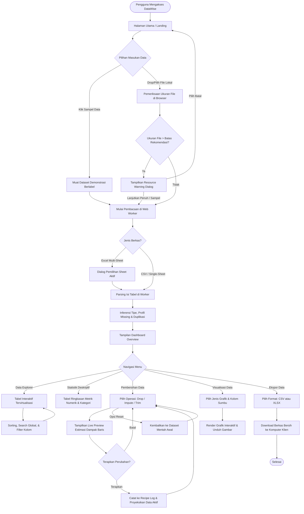

# DataWise — Product Requirements Document (PRD) & Technical Blueprint
**Version:** 1.1.0-REVISED  
**Role:** Senior Product Manager, Product Designer, Data Analyst & Software Architect  
**Status:** Disetujui (Approved Baseline)  
**Target File:** `docs/PRD.md`

---

## DAFTAR ISI
1. [Bagian 1: Product Requirements Document (PRD)](#bagian-1-product-requirements-document-prd)
   - 1.1 Ringkasan Produk & Visi
   - 1.2 Masalah Pengguna & Value Proposition
   - 1.3 Tujuan Produk (Goals) & Non-Goals
   - 1.4 Target Pengguna
   - 1.5 User Personas
   - 1.6 User Stories
   - 1.7 Persyaratan Fungsional (FR)
   - 1.8 Persyaratan Non-Fungsional (NFR)
   - 1.9 Alur Penggunaan Utama
   - 1.10 Kriteria Penerimaan MVP
   - 1.11 Batasan Sistem & Rekomendasi Beban
   - 1.12 Risiko Teknis & Mitigasi
   - 1.13 Persyaratan Privasi, Keamanan & Rencana Audit Jaringan
   - 1.14 Rencana Pengujian & Kualitas Empiris
   - 1.15 Metrik Keberhasilan Produk
2. [Bagian 2: MVP Scope & Pentahapan Rilis](#bagian-2-mvp-scope--pentahapan-rilis)
   - 2.1 Tahap 1: MVP Foundation (Fondasi Ingestion & Profiling)
   - 2.2 Tahap 2: MVP Functional (Analitik, Pembersihan, & Ekspor)
   - 2.3 Fitur Ditunda (Post-MVP / v1.1+)
   - 2.4 Matriks Dependensi Antar-Fitur
   - 2.5 Urutan Implementasi Logis
3. [Bagian 3: User Flow & Diagram Interaksi](#bagian-3-user-flow--diagram-interaksi)
4. [Bagian 4: Kebijakan Data, Missing Values & Spesifikasi Statistik](#bagian-4-kebijakan-data-missing-values--spesifikasi-statistik)
   - 4.1 Kebijakan Missing Values & Nilai Kosong
   - 4.2 Inferensi Tipe Data & Penanganan Nilai Khusus (ID, Tanggal, Desimal)
   - 4.3 Spesifikasi Baku Komputasi Statistik & Penanganan Edge Cases
   - 4.4 Format Pembulatan & Presisi Numerik
5. [Bagian 5: Technical Architecture & System Design](#bagian-5-technical-architecture--system-design)
   - 5.1 Evaluasi & Justifikasi Tech Stack
   - 5.2 Arsitektur Sistem Modular & Pemisahan Layer
   - 5.3 Manajemen State & Pipeline Transformasi Data (Immutable Recipe Engine)
   - 5.4 Penanganan File Besar, Web Worker & Alokasi Memori
   - 5.5 Sasaran Benchmark Kinerja & Metodologi Pengujian
   - 5.6 Strategi Verifikasi dengan Gold Standard Datasets
6. [Bagian 6: UI/UX Direction & Design System](#bagian-6-uiux-direction--design-system)
   - 6.1 Filosofi Visual Merek DataWise
   - 6.2 Sistem Warna & Alasan Pemilihan (Color Tokens)
   - 6.3 Tipografi, Spacing, & Struktur Visual
   - 6.4 Responsivitas Multi-Perangkat (Desktop, Tablet, Mobile)
   - 6.5 Spesifikasi 8 Tampilan Inti
   - 6.6 Indikator Status Sistem (Empty, Loading, Warning, Error)
   - 6.7 Penanganan Dataset Demonstrasi (Sample Data)
7. [Bagian 7: Acceptance Criteria (BDD / Given-When-Then)](#bagian-7-acceptance-criteria-bdd--given-when-then)
8. [Bagian 8: Testing Strategy & Edge Cases Matrix](#bagian-8-testing-strategy--edge-cases-matrix)
   - 8.1 Matriks Penanganan Kasus Ekstrem (Edge Cases)
   - 8.2 Rencana Pengujian Otomatis (Unit, Integration, Round-Trip)
9. [Bagian 9: Risk Register](#bagian-9-risk-register)
10. [Bagian 10: Implementation Roadmap & Granular Task Breakdown](#bagian-10-implementation-roadmap--granular-task-breakdown)
    - 10.1 Pentahapan Berbasis Kriteria Penyelesaian
    - 10.2 Task Breakdown Detail untuk MVP Foundation, Functional & QA
11. [Lampiran: Asumsi, Keputusan Kunci, & Langkah Lanjutan](#lampiran-asumsi-keputusan-kunci--langkah-lanjutan)

---

# Bagian 1: Product Requirements Document (PRD)

## 1.1 Ringkasan Produk & Visi
**DataWise** adalah aplikasi web analisis dan pembersihan data berbasis *client-side* (*zero server-side data upload*), dirancang khusus untuk memfasilitasi mahasiswa, peneliti, pemula data analytics, dan staf operasional dalam mengeksplorasi, memahami, membersihkan, serta memvisualisasikan dataset tabular tanpa hambatan teknis penulisan sintaks pemrograman (seperti Python, R, atau SQL).

**Visi Inti:** Menghadirkan alat bantu analisis data yang intuitif tanpa kode, dengan **integritas statistik yang terverifikasi secara empiris**, **arsitektur pemrosesan lokal yang dapat diaudit**, serta **antarmuka modern yang berfokus pada kejelasan data**.

## 1.2 Masalah Pengguna & Value Proposition
| Masalah Pengguna Saat Ini | Solusi DataWise |
| :--- | :--- |
| **Hambatan Koding (Python/Pandas/R):** Mahasiswa & pemula sering terhambat sintaks error atau instalasi environment (Jupyter/Anaconda) saat hanya ingin memeriksa missing value atau membuat histogram sederhana. | **GUI No-Code Intuitif:** Seluruh operasi inspeksi kualitas, transformasi, dan visualisasi dijalankan melalui interaksi klik yang terpandu dan langsung terlihat dampaknya. |
| **Keterbatasan Excel Tradisional:** Sering lambat saat menangani puluhan ribu baris, formula rentan error manusia, perubahan data sulit dilacak, dan tipe data sering diubah otomatis tanpa konfirmasi pengguna. | **Pipeline Pembersihan Berbasis Audit (Recipe Engine):** Perubahan data dicatat langkah demi langkah secara transparan, tidak merusak file asli (*non-destructive*), dan dapat dibatalkan atau di-reset kapan saja. |
| **Kekhawatiran Privasi Data Riset:** Mengunggah dataset ke platform analitik berbasis cloud sering kali berisiko melanggar etika riset, privasi responden, atau kebijakan data sensitif organisasi. | **Pemrosesan Lokal di Browser (Client-Side Engine):** File dataset diparsing dan diproses di memori RAM browser pengguna. Tidak ada data pengguna yang dikirim ke server backend untuk diproses. |
| **Ketidakjelasan Penanganan Nilai Kosong:** Software sederhana sering menyamakan `0`, `null`, dan teks `"NA"`, menghasilkan rata-rata dan statistik yang bias. | **Kebijakan Data Eksplisit & Transparan:** Membedakan secara tegas nilai kosong murni, whitespace, dan teks penanda, serta memberi kendali penuh kepada pengguna untuk mengonfirmasi interpretasi data. |

## 1.3 Tujuan Produk (Goals) & Non-Goals

### Goals (Tujuan Produk):
1. **Verifiable Quality:** Menyediakan mesin kalkulasi statistik deskriptif dan pembersihan data yang hasilnya terverifikasi identik dengan pustaka statistik baku (seperti Python Pandas/NumPy) dalam batas toleransi numerik yang ditentukan.
2. **Accessible Exploration:** Memungkinkan pengguna mengimpor dataset tabular (CSV dan Excel), memeriksa struktur kolom, mengidentifikasi missing values, dan mendeteksi baris duplikat tanpa hambatan konfigurasi.
3. **Non-Destructive Operations:** Memastikan data asli pengguna selalu tersimpan aman di memori, dan setiap manipulasi data dapat ditinjau dampaknya (*live preview*) sebelum dieksekusi.
4. **Export Readiness:** Menghasilkan output data bersih dalam format CSV dan Excel yang terstandarisasi, siap digunakan untuk penulisan karya ilmiah, skripsi, maupun pelaporan kerja.
5. **Measurable Performance:** Mencapai target kinerja parsing dan komputasi yang responsif pada dataset tabular hingga 50.000 baris pada perangkat laptop standar melalui pengujian terukur.

### Non-Goals (Bukan Tujuan MVP):
1. **Bukan Pengganti Relational Database:** Tidak mendukung operasi SQL JOIN multi-tabel, transaksi ACID, atau penyimpanan terdistribusi.
2. **Bukan Platform Machine Learning/AutoML:** Tidak melakukan pemodelan prediktif, regresi multivariat kompleks, atau pelatihan model kecerdasan buatan pada rilis awal.
3. **Bukan Cloud File Storage:** DataWise tidak menyediakan akun pengguna, autentikasi cloud, atau database server untuk menyimpan dataset. Data bersifat sesi lokal (*ephemeral*).
4. **Bukan Big Data Processing Engine:** Tidak dirancang untuk memproses dataset skala gigabyte atau jutaan baris yang membutuhkan arsitektur cluster server (seperti Apache Spark).

## 1.4 Target Pengguna
1. **Mahasiswa Tugas Akhir / Peneliti Akademik:** Memiliki data kuesioner atau hasil eksperimen (500 – 10.000 baris), perlu membersihkan missing values, memeriksa ringkasan statistik deskriptif untuk Bab 4 skripsi, dan mengekspor visualisasi.
2. **Mahasiswa Pengantar Data Analytics / Statistika:** Memerlukan sarana cepat untuk memvalidasi pemahaman konsep statistik (mean, median, IQR, distribusi data) pada dataset latihan tanpa frustrasi akibat error instalasi pustaka pemrograman.
3. **Pemula Data Analytics & Career Switcher:** Memerlukan antarmuka visual untuk memahami alur kerja Exploratory Data Analysis (EDA) dan pembersihan data sebelum mendalami kode program.
4. **Pengguna Spreadsheet & Staf Operasional:** Sering mengekspor laporan CSV/Excel dari sistem kantor, perlu merapikan format spasi, menghapus baris ganda, dan menyaring anomali sebelum diserahkan ke atasan.

## 1.5 User Personas

### Persona A: Sarah (Mahasiswa Skripsi Ilmu Komunikasi, 22 tahun)
- **Latar Belakang:** Menguasai spreadsheet dasar, tidak memiliki latar belakang komputasi, cemas bila harus mempelajari Python atau membayar lisensi software statistik yang mahal.
- **Kebutuhan:** Memeriksa 1.500 baris data kuesioner survei, mencari tahu persentase responden yang melewatkan pertanyaan tertentu, menghapus data pengisian ganda, dan memperoleh tabel mean/median yang valid.
- **Pain Points:** Takut datanya terdistorsi secara otomatis oleh Excel; cemas datanya bocor bila diunggah ke website gratisan di internet.

### Persona B: Budi (Pemula Data Analytics, 25 tahun)
- **Latar Belakang:** Sedang mengikuti program pelatihan data analytics mandiri.
- **Kebutuhan:** Memverifikasi hasil perhitungan manual statistik deskriptif dan memahami bentuk distribusi frekuensi melalui histogram.
- **Pain Points:** Menghabiskan terlalu banyak waktu untuk debugging kode parsing CSV dan syntax data frame daripada memahami karakteristik dataset.

### Persona C: Hendra (Staf Operasional Logistik, 31 tahun)
- **Latar Belakang:** Bekerja dengan puluhan ribu baris data manifest pengiriman setiap hari.
- **Kebutuhan:** Mendeteksi nomor resi duplikat, membersihkan spasi berlebih pada kolom kota/alamat, dan menyaring transaksi bermasalah.
- **Pain Points:** Komputer sering mengalami lag saat membuka file besar di spreadsheet biasa; kebijakan kantor melarang keras mengunggah data manifest ke server cloud pihak ketiga.

## 1.6 User Stories
- **US-01 (Import CSV):** *Sebagai* pengguna, *saya ingin* memilih atau melakukan drag-and-drop file CSV, *agar* saya dapat segera memeriksa dataset tanpa konfigurasi manual delimiter yang rumit.
- **US-02 (Import Excel):** *Sebagai* peneliti, *saya ingin* memilih sheet tertentu dari file workbook Excel, *agar* saya hanya menganalisis tabel data yang relevan.
- **US-03 (Preview & Skema Kolom):** *Sebagai* mahasiswa, *saya ingin* melihat preview baris data disertai badge tipe data yang terdeteksi, *agar* saya dapat memastikan kolom angka tidak salah dikenali sebagai teks.
- **US-04 (Ringkasan Kualitas Data):** *Sebagai* analis, *saya ingin* melihat total baris, total kolom, jumlah missing value, dan jumlah baris duplikat, *agar* saya mengetahui tingkat kebersihan data saya secara instan.
- **US-05 (Statistik Deskriptif):** *Sebagai* peneliti, *saya ingin* melihat tabel ringkasan mean, median, modus, standar deviasi, min, max, dan kuartil untuk setiap variabel numerik, *agar* saya dapat melampirkannya pada laporan penelitian.
- **US-06 (Eksplorasi & Filter):** *Sebagai* pengguna, *saya ingin* melakukan pencarian kata kunci dan menyaring data berdasarkan kondisi nilai kolom, *agar* saya dapat mengisolasi baris data tertentu.
- **US-07 (Pembersihan Data):** *Sebagai* staf operasional, *saya ingin* menghapus baris duplikat atau mengisi missing value dengan median/rata-rata melalui menu terpandu, *agar* dataset saya menjadi lengkap dan konsisten.
- **US-08 (Reset & Audit Riwayat):** *Sebagai* pengguna, *saya ingin* melihat daftar tindakan pembersihan yang telah saya lakukan dan memiliki opsi mereset ke data awal, *agar* saya tidak khawatir kehilangan data akibat kesalahan klik.
- **US-09 (Visualisasi):** *Sebagai* mahasiswa, *saya ingin* membuat bar chart dan histogram dari kolom yang saya pilih, *agar* saya dapat memahami sebaran data secara visual.
- **US-10 (Ekspor Data Bersih):** *Sebagai* pengguna, *saya ingin* mengunduh dataset hasil pembersihan dalam format CSV atau Excel, *agar* dapat langsung digunakan untuk analisis lanjutan.

## 1.7 Persyaratan Fungsional (FR)
- **FR-01 (File Ingestion):** Sistem harus mendukung input file berekstensi `.csv`, `.tsv`, `.xlsx`, dan `.xls`.
- **FR-02 (Delimiter & Encoding Handling):** Sistem harus mendeteksi delimiter CSV (koma, titik koma, tab) secara otomatis dari sampel baris awal, serta menyediakan pemilih delimiter manual jika deteksi awal tidak sesuai. Encoding default adalah UTF-8 dengan deteksi karakter anomali.
- **FR-03 (Excel Sheet Selector):** Sistem harus membaca daftar sheet pada file Excel multi-sheet dan memungkinkan pengguna memilih satu sheet aktif untuk dimuat.
- **FR-04 (Type Inference Engine):** Sistem harus mengevaluasi isi data per kolom untuk mengklasifikasikan tipe: `Numeric (Integer/Float)`, `Text/Categorical`, `DateTime`, atau `Boolean`.
- **FR-05 (Non-Destructive Type Override):** Pengguna harus dapat mengubah interpretasi tipe data kolom (misal mengubah kolom angka Kode Pos menjadi Teks) tanpa mengubah nilai asli data di memori.
- **FR-06 (Missing & Duplicate Profiling):** Sistem harus menghitung jumlah dan persentase missing values per kolom serta mendeteksi baris yang identik (*exact duplicate rows*).
- **FR-07 (Descriptive Statistics Calculator):** Sistem harus membedakan metrik kualitas data, metrik numerik, dan metrik kategorikal secara jelas. Sistem harus menghitung metrik untuk kolom numerik (Count, Missing, Sum, Mean, Median, Mode, Sample Standard Deviation, Sample Variance, Min, Max, Q1, Q3, IQR) dan kolom kategorikal (Count, Missing, Unique Count, Top Value, Frekuensi Nilai Teratas, Frekuensi Kategorikal).
- **FR-08 (Interactive Data Grid):** Sistem harus menyajikan tabel data dengan dukungan virtual scrolling untuk rendering ribuan baris, pengurutan kolom (sorting ascending/descending), dan indikator tipe data.
- **FR-09 (Data Search & Filtering):** Sistem harus mendukung pencarian global berbasis teks dan filter berbasis kondisi per kolom (equals, contains, greater than, less than, between).
- **FR-10 (Data Cleaning Engine):** Sistem harus menyediakan operasi pembersihan terarah:
  - Hapus baris yang mengandung missing value pada kolom terpilih atau seluruh kolom.
  - Imputasi nilai kosong (dengan Mean, Median, Mode, atau Nilai Tetap).
  - Hapus baris duplikat persis.
  - Trim whitespace (menghapus spasi di awal dan akhir teks).
  - Hapus kolom atau ubah nama header kolom.
- **FR-11 (Recipe Log & Live Preview):** Sistem harus mencatat setiap operasi pembersihan dalam daftar riwayat (*Recipe*), menampilkan estimasi dampak (jumlah baris/nilai yang terpengaruh) sebelum eksekusi, serta menyediakan opsi kembali ke dataset asli (*Reset to Original*).
- **FR-12 (Chart Generator):** Sistem harus mampu menghasilkan 4 jenis grafik: Bar Chart (kategori vs nilai/frekuensi), Histogram (sebaran frekuensi dengan pilihan jumlah bin), Line Chart (urutan indeks), dan Scatter Plot (relasi 2 kolom numerik).
- **FR-13 (Data Exporter):** Sistem harus mengonversi dataset aktif hasil pembersihan ke dalam file `.csv` (UTF-8) atau `.xlsx` untuk diunduh langsung ke komputer pengguna.

## 1.8 Persyaratan Non-Fungsional (NFR)
- **NFR-01 (Akurasi Matematis Terverifikasi):** Seluruh fungsi agregasi statistik wajib memenuhi standar toleransi numerik terstandarisasi terhadap *ground-truth* pustaka ilmiah acuan (NumPy, SciPy, Pandas) sesuai formulasi Bagian 4.3.E: kriteria baku $\text{abs}(x_{\text{calc}} - x_{\text{ref}}) \le (\text{atol} + \text{rtol} \times \text{abs}(x_{\text{ref}}))$ dengan parameter toleransi absolut $\text{atol} = 1 \times 10^{-5}$ dan toleransi relatif $\text{rtol} = 1 \times 10^{-5}$ untuk seluruh metrik floating-point kontinu, serta toleransi nol ($\text{atol} = 0, \text{rtol} = 0$, kecocokan eksak) untuk seluruh hitungan diskrit, missing values, duplikat, nilai batas (min/max), dan nilai/frekuensi modus.
- **NFR-02 (Responsivitas UI & Background Execution):** Operasi parsing dan kalkulasi komputasi berat tidak boleh memblokir interaksi antarmuka pengguna (wajib didelegasikan ke Web Worker atau asinkron terpisah).
- **NFR-03 (Data Privacy Auditability):** Seluruh pemrosesan dataset dilakukan secara lokal di lingkungan klien. Lalu lintas jaringan aplikasi harus dapat diaudit untuk membuktikan ketiadaan transmisi payload data ke server luar.
- **NFR-04 (Usability & Accessibility):** Antarmuka harus memenuhi standar kontras WCAG 2.1 Level AA (minimal 4.5:1 untuk teks normal), menyediakan navigasi keyboard pada kontrol utama, serta menyajikan angka numerik dalam format yang mudah dibaca (*tabular numbers*).
- **NFR-05 (Maintainability & Code Hygiene):** Proyek dibangun dengan TypeScript Strict Mode (`strict: true`), pemisahan domain logika komputasi murni dari komponen antarmuka visual, dan cakupan unit test pada modul statistik > 90%.

## 1.9 Alur Penggunaan Utama
1. **Pemasukan Data (Ingestion):** Pengguna menjatuhkan file CSV/Excel ke dropzone atau memilih dataset demonstrasi berlabel.
2. **Validasi & Konfigurasi:** Sistem memvalidasi struktur file. Jika Excel multi-sheet, pengguna memilih sheet; jika delimiter ambigu, pengguna dapat memilih delimiter yang sesuai.
3. **Pemeriksaan Awal (Overview & Quality):** Sistem menampilkan kartu metrik jumlah baris, kolom, tingkat kelengkapan data, serta tabel rincian missing values dan duplikat.
4. **Eksplorasi & Statistik:** Pengguna meninjau tabel data tervirtualisasi di *Data Explorer* atau memeriksa tabel *Statistik Deskriptif*.
5. **Pembersihan Data (Cleaning):** Pengguna memilih operasi pembersihan (misal: isi nilai kosong dengan median), meninjau preview dampak, lalu mengeksekusi operasi ke dalam Recipe.
6. **Visualisasi Data:** Pengguna beralih ke tab *Visualisasi*, memilih variabel dan tipe grafik untuk menganalisis distribusi atau korelasi visual.
7. **Ekspor Data Bersih:** Pengguna memilih format CSV atau Excel untuk mengunduh dataset yang telah dibersihkan.

## 1.10 Kriteria Penerimaan MVP
- File CSV dan Excel standar berukuran hingga batas rekomendasi (30 MB untuk CSV, 15 MB untuk Excel) dapat diparsing dan diproses tanpa crash browser tab.
- Evaluasi inferensi tipe data menghasilkan klasifikasi yang tepat pada dataset pengujian terstandarisasi, dengan opsi override tipe yang berfungsi penuh.
- Hasil kalkulasi seluruh metrik statistik (sum, mean, median, varians sampel, standar deviasi sampel, kuartil Type-7, IQR, min, max, modus, missing count, dan frekuensi kategorikal) pada dataset referensi (Iris dan Titanic) wajib terverifikasi memenuhi batas toleransi terhadap pustaka acuan Python (NumPy, SciPy, Pandas) sesuai parameter baku $\text{atol} = 1 \times 10^{-5}$ dan $\text{rtol} = 1 \times 10^{-5}$ untuk metrik kontinu, serta kecocokan eksak ($\text{atol} = 0, \text{rtol} = 0$) untuk metrik diskrit dan ekstrem.
- Ekspor file CSV dan Excel menghasilkan dokumen valid yang dapat dibuka kembali di Microsoft Excel dan Google Sheets tanpa kerusakan karakter (*encoding errors*).
- Tidak ada lalu lintas jaringan keluar yang membawa isi data pengguna selama seluruh alur penggunaan.

## 1.11 Batasan Sistem & Rekomendasi Beban
1. **Batas Rekomendasi Beban Browser:**
   - *File CSV:* Rekomendasi optimal $\le$ 30 MB; batas peringatan $\le$ 50 MB.
   - *File Excel (.xlsx):* Rekomendasi optimal $\le$ 15 MB; batas peringatan $\le$ 25 MB. (*Rasional:* Format .xlsx merupakan arsip ZIP berisi XML terkompresi; proses dekompresi di memori browser membutuhkan RAM 5–8 kali lebih besar dari ukuran file mentah).
   - *Jumlah Baris & Kolom Rekomendasi:* Hingga 50.000 baris dan 40 kolom untuk menjamin kelancaran navigasi antarmuka pada komputer dengan RAM 8 GB.
2. **Perilaku Ketika Melebihi Batas:** File yang melebihi batas rekomendasi akan memicu *Resource Warning Dialog*, memberikan pilihan kepada pengguna untuk melanjutkan dengan risiko penurunan performa, memuat sampel 10.000 baris pertama, atau membatalkan proses.
3. **Batasan Sesi:** Sesi bersifat *in-memory ephemeral*; memuat ulang halaman (reload) akan mengosongkan dataset aktif kecuali pengguna telah mengekspor hasilnya.

## 1.12 Risiko Teknis & Mitigasi
- **Risiko R-01 (Out of Memory saat Parsing Excel Besar):** File Excel berukuran besar menyebabkan heap memory tab browser melonjak tinggi.  
  *Mitigasi:* Terapkan batas ukuran file di dropzone sebelum file dibaca, gunakan pembacaan SheetJS berbasis *cell-only/dense array*, dan sediakan opsi pemuatan sampel.
- **Risiko R-02 (Antarmuka Membeku / Jank saat Analisis):** Perhitungan statistik pada puluhan ribu baris memblokir event loop browser.  
  *Mitigasi:* Delegasikan seluruh komputasi parsing, inferensi tipe, dan kalkulasi agregasi statistik ke Web Worker terpisah.
- **Risiko R-03 (Distorsi Desimal Akibat Format Lokal):** Angka berformat desimal koma (`,`) khas regional Indonesia/Eropa salah terbaca sebagai teks atau salah skala.  
  *Mitigasi:* Implementasikan heuristik deteksi konsistensi desimal koma vs titik, serta sediakan toggle pilihan desimal di modal konfirmasi impor.
- **Risiko R-04 (Ambigu Format Tanggal):** Format seperti `04/05/2023` ambigu antara 4 Mei atau 5 April.  
  *Mitigasi:* Periksa seluruh nilai kolom untuk mencari tanggal > 12 guna menetapkan pola; jika seluruhnya ambigu, tandai status sebagai ambigu dan pertahankan tipe string sampai pengguna memilih konvensi yang benar.

## 1.13 Persyaratan Privasi, Keamanan & Rencana Audit Jaringan
1. **Pemrosesan Lokal Murni:** Seluruh mesin pembacaan berkas, transformasi data, dan kalkulasi analisis berjalan 100% di memori RAM peramban pengguna (*zero server-side data processing*).
2. **Kebijakan Lalu Lintas Jaringan yang Diizinkan (Allowed Traffic Policy):**
   - *Metode & Permintaan yang Diizinkan:* Hanya metode HTTP `GET` yang diizinkan, khusus untuk memuat aset aplikasi web statis (dokumen HTML, bundel JavaScript aplikasi, stylesheet CSS, gambar/ikon lokal, dan berkas font lokal) pada saat inisialisasi halaman.
   - *Domain Tujuan yang Diperbolehkan:* Secara ketat dibatasi hanya ke domain asal aplikasi (`same-origin`). Seluruh permintaan ke domain eksternal atau pihak ketiga (*cross-origin / third-party*) dilarang keras.
3. **Pemeriksaan Ketat Terhadap Payload, Parameter, & Telemetri:**
   - *Request Payload (Body):* Dilarang mengirimkan payload data apapun (wajib 0-byte data body) pada seluruh jenis permintaan jaringan.
   - *URL Query Parameters & Headers:* Dilarang menyertakan token dataset, nama kolom, cuplikan baris, ringkasan statistik, atau metadata berkas pada query strings maupun custom headers.
   - *Log Error Eksternal & Bug Tracking:* Dilarang mengintegrasikan layanan pemantauan eksternal (seperti Sentry, Datadog, LogRocket, Bugsnag) yang berpotensi mengirimkan rekaman memori atau stack trace berisi cuplikan data pengguna.
   - *Telemetri & Analitik:* Dilarang mengaktifkan pustaka analitik pihak ketiga (seperti Google Analytics, Mixpanel, Segment, PostHog) untuk menangkap aktivitas interaksi dataset.
4. **Kebijakan Penyimpanan (Storage):** Pada tahap MVP, dataset **tidak disimpan di localStorage** (menghindari batas kuota 5 MB dan risiko kebocoran XSS) dan tidak ditulis ke media penyimpanan permanen secara otomatis. Data bersifat *in-memory ephemeral* dan terhapus secara alami saat tab peramban ditutup.
5. **Rencana & Prosedur Audit Jaringan (Network Audit Plan):**
   - *Prosedur Interaktif:* Buka Chrome/Firefox DevTools -> Tab *Network* -> Centang *Preserve Log*. Impor dataset pengujian yang berisi dummy data sensitif (nama, NIK, nominal transaksi). Jalankan seluruh alur: parsing, profiling, kalkulasi statistik, pembersihan, dan ekspor.
   - *Target Kelulusan Audit:* Seluruh lalu lintas jaringan keluar wajib terverifikasi hanya berupa HTTP GET ke domain `same-origin` untuk pemuatan aset statis lokal. Pemeriksaan harus membuktikan ketiadaan request POST/PUT/PATCH/DELETE, ketiadaan payload body, ketiadaan query parameters pembawa metadata, dan ketiadaan transmisi log eksternal atau telemetri. Sesi audit dinyatakan berhasil hanya setelah seluruh kriteria tersebut terpenuhi pada pengujian empiris nyata.

## 1.14 Rencana Pengujian & Kualitas Empiris
- **Unit Testing Modul Statistik:** Minimal 40 skenario pengujian unit yang memvalidasi fungsi sum, mean, median, varians sampel, standar deviasi sampel, kuartil Type-7, IQR, min, max, modus/multimodal, dan frekuensi kategorikal terhadap dataset sintetis terstandarisasi.
- **Verifikasi Empiris Gold Standard Datasets:** Menguji dataset ilmiah resmi (Iris dan Titanic) dengan target komparasi terhadap pustaka acuan Python (NumPy, SciPy, Pandas) sesuai formulasi Bagian 4.3.E:
  - **Sum dan Mean:** Diverifikasi terhadap `numpy.sum` dan `numpy.mean` (toleransi $\text{atol} = 1 \times 10^{-5}, \text{rtol} = 1 \times 10^{-5}$).
  - **Median:** Diverifikasi terhadap `numpy.median` (toleransi $\text{atol} = 1 \times 10^{-5}, \text{rtol} = 1 \times 10^{-5}$).
  - **Varians dan Std Dev:** Diverifikasi terhadap `numpy.var(ddof=1)` dan `numpy.std(ddof=1)` dengan Bessel's correction $N-1$ (toleransi $\text{atol} = 1 \times 10^{-5}, \text{rtol} = 1 \times 10^{-5}$).
  - **Kuartil dan IQR:** Diverifikasi terhadap `numpy.percentile(method='linear')` (Type-7) dan `scipy.stats.iqr(scale=1.0, interpolation='linear')` (toleransi $\text{atol} = 1 \times 10^{-5}, \text{rtol} = 1 \times 10^{-5}$).
  - **Min dan Max:** Diverifikasi terhadap `numpy.min` dan `numpy.max` (toleransi $\text{atol} = 0, \text{rtol} = 0$, kecocokan eksak).
  - **Modus dan Multimodal:** Diverifikasi terhadap `scipy.stats.mode` dan algoritma evaluasi tie-breaking hashmap (toleransi $\text{atol} = 0, \text{rtol} = 0$, kecocokan eksak nilai dan frekuensi).
  - **Statistik Kategorikal & Missing Counts:** Diverifikasi terhadap `pandas.Series.value_counts()` dan `isna().sum()` (toleransi $\text{atol} = 0, \text{rtol} = 0$ untuk hitungan frekuensi absolut dan missing count; $\text{atol} = 1 \times 10^{-5}, \text{rtol} = 1 \times 10^{-5}$ untuk persentase frekuensi relatif).
- **Target Kualitas:** Seluruh sasaran di atas merupakan kriteria verifikasi empiris yang wajib dipenuhi seluruhnya tanpa kegagalan assertion saat pengujian dijalankan, bukan klaim kelulusan sebelum implementasi.
- **Regression Testing Edge Cases:** Menguji file kosong (0 byte), file tanpa baris (hanya header), kolom bernilai tunggal ($N=1$), kolom dengan nilai identik (varians = 0), baris dengan jumlah kolom tidak konsisten, dan dataset dengan karakter Unicode khusus.

## 1.15 Metrik Keberhasilan Produk
1. **Target Waktu Pemrosesan Awal (Time-to-Insight Target):** Menampilkan ringkasan overview dan profil kolom pertama dalam waktu terukur < 3 detik untuk dataset 10.000 baris pada perangkat benchmark standar.
2. **Tingkat Keberhasilan Parsing:** Berhasil membaca > 98% file CSV dan Excel berformat standar tanpa error fatal.
3. **Nol Deviasi Melampaui Toleransi:** Deviasi numerik terhadap pustaka acuan independen (NumPy, SciPy, Pandas) wajib berada di dalam batas toleransi terpadu ($\text{atol} = 1 \times 10^{-5}, \text{rtol} = 1 \times 10^{-5}$ untuk metrik kontinu; $\text{atol} = 0, \text{rtol} = 0$ untuk metrik diskrit) yang ditetapkan pada Tabel Kebijakan Baku Toleransi Statistik pada seluruh suite pengujian otomatis.
4. **Target Audit Jaringan:** Menargetkan 100% kelulusan audit verifikasi jaringan, memastikan ketiadaan kebocoran metadata atau isi dataset keluar.

---

# Bagian 2: MVP Scope & Pentahapan Rilis

Untuk memastikan kualitas kode, akurasi komputasi yang teruji, dan kestabilan performa sebelum menambah kompleksitas fitur, pengembangan MVP DataWise dibagi secara ketat menjadi **dua tahap pengembangan berurutan**.

```mermaid
flowchart LR
    subgraph Tahap 1: MVP Foundation
        F1[CSV/TSV Parsing] --> F2[Excel Parsing]
        F2 --> F3[Dataset Preview]
        F3 --> F4[Dataset Overview]
        F4 --> F5[Type Inference & Column Profiling]
        F5 --> F6[Missing Value & Duplicate Detection]
        F6 --> F7[Dropzone & File Validation]
    end

    subgraph Tahap 2: MVP Functional
        F7 -.-> M1[Descriptive Stats Engine]
        M1 --> M2[Descriptive Stats UI]
        M2 --> M3[Interactive Data Grid]
        M3 --> M4[Data Cleaning & Recipe]
        M4 --> M5[Visualization Studio]
        M5 --> M6[CSV/XLSX Export]
    end

    subgraph Post-MVP / v1.1+
        M5 -.-> P1[Correlation Heatmap]
        P1 --> P2[Outlier Detection Z-Score]
        P2 --> P3[Laporan Analisis PDF]
    end
```



## 2.1 Tahap 1: MVP Foundation (Fondasi Ingestion & Profiling)
Fokus tahap ini adalah membangun jalur pipa data (*data pipeline*) yang stabil, aman dari crash memori, serta mampu membaca dan memetakan struktur dataset dengan benar.

### A. Strategi Implementasi Modular & Pengujian Terisolasi (Headless Modules)
Untuk menjamin kualitas dan mencegah dependensi melingkar (*circular dependencies*), modul fondasi dirancang dengan arsitektur modular yang terpisah antara logika pemrosesan data (domain/worker) dan antarmuka pengguna:
1. **Pengembangan & Pengujian Terisolasi Sebelum Integrasi UI:**
   - Modul parser (`FND-01`, `FND-02`), pembuat pratinjau (`FND-03`), kalkulator ikhtisar (`FND-04`), inferensi tipe & profil kolom (`FND-05`), serta deteksi missing value dan duplikat (`FND-06`) dikembangkan sebagai modul murni (*headless pure modules*) di layer domain/worker.
   - Seluruh modul tersebut diuji secara mandiri sebelum antarmuka Dropzone terhubung, menggunakan **Test Fixtures** (file CSV sintetis beraneka delimiter, file Excel multi-sheet, dan matriks data array mock yang disimpan di direktori `/test/fixtures`).
   - Pendekatan ini memungkinkan pengujian unit otomatis dijalankan secara cepat dan deterministik tanpa bergantung pada event DOM peramban.
2. **Integrasi UI & Jalur Pipa Penuh (FND-07):**
   - Setelah modul `FND-01` sampai `FND-06` terbukti handal melalui pengujian unit berbasis fixtures, modul `FND-07` dibangun untuk menyediakan komponen interaktif Dropzone, validasi batas ukuran berkas (30 MB CSV / 15 MB Excel), dialog pemilihan sheet Excel, serta memicu pengiriman berkas ke pipeline Web Worker.
3. **Kriteria Penerimaan End-to-End (E2E) MVP Foundation:**
   - **Alur Utuh:** Pengguna menjatuhkan berkas ke Dropzone -> Sistem memvalidasi ekstensi dan ukuran berkas -> Worker mengeksekusi parsing (`FND-01`/`FND-02`) -> Ekstraksi pratinjau 100 baris pertama (`FND-03`) -> Kalkulasi metrik ikhtisar (`FND-04`) -> Inferensi skema tipe data (`FND-05`) -> Deteksi sel kosong dan duplikat (`FND-06`) -> Antarmuka bertransisi menampilkan Dashboard Overview dengan seluruh kartu metrik terisi lengkap.
   - **Target Responsivitas:** Seluruh alur end-to-end selesai dan Dashboard Overview tampil dalam waktu $< 3$ detik untuk dataset standar 10.000 baris tanpa terjadi freeze pada Main UI Thread.

### B. Matriks Spesifikasi & Kriteria Kelulusan Tahap Foundation

| Fitur | Deskripsi Fungsional | Kriteria Kelulusan Tahap Foundation |
| :--- | :--- | :--- |
| **FND-01: CSV/TSV Parsing** | Parsing file `.csv` dan `.tsv` dengan deteksi delimiter otomatis (koma, titik koma, tab) dan penanganan encoding UTF-8 di Web Worker. | Wajib berhasil memarsing seluruh 10 variasi file CSV sintetis (beragam delimiter dan baris ber-quote) pada test fixtures tanpa kegagalan atau pemotongan baris. |
| **FND-02: Excel Parsing dan Sheet Selector** | Membaca workbook `.xlsx` dan `.xls`, mengekstrak metadata sheets, dan memungkinkan pemilihan sheet aktif via dialog konfigurasi. | Wajib berhasil mengekstrak seluruh nama sheet pada workbook multi-sheet fixture dan mengonversi cell sheet aktif menjadi array tabular tanpa memory leak. |
| **FND-03: Dataset Preview** | Menampilkan 100 baris pertama dataset dalam tabel pratinjau tabular sederhana segera setelah proses parsing selesai. | Tabel pratinjau ter-render < 300 ms setelah data siap di memory store, dengan perataan teks/angka yang rapi dan kolom yang tidak tertukar. |
| **FND-04: Dataset Overview** | Menghitung metrik dasar: total baris, total kolom, estimasi penggunaan memori di heap browser, serta status validitas file. | Metrik jumlah baris dan kolom 100% akurat sesuai ukuran file aktual; penghitungan estimasi memori mencerminkan alokasi data aktif. |
| **FND-05: Type Inference dan Column Profiling** | Mengklasifikasikan kolom menjadi `Numeric`, `Text`, `Date`, atau `Boolean`, dengan tombol override manual per kolom di header. | Algoritma inferensi mencapai akurasi > 95% pada dataset benchmark; tindakan override tipe tersimpan di metadata tanpa merusak nilai asli. |
| **FND-06: Missing Value dan Duplicate Detection** | Menghitung jumlah cell kosong murni (`null`/`undefined`/`""`), baris spasi, dan jumlah baris yang identik persis. | Deteksi jumlah missing values dan baris duplikat wajib terverifikasi akurat 100% (kecocokan eksak integer $\epsilon = 0$) terhadap hasil acuan ground truth. |
| **FND-07: Dropzone, File Validation, dan penghubung UI ke pipeline parsing** | Membangun antarmuka drag-and-drop file, validasi batas ukuran (30 MB CSV / 15 MB Excel), dan menghubungkan UI dengan pipeline pemrosesan. | Dropzone merespons drag-and-drop, menolak file rusak/melebihi batas dengan pesan edukatif, dan berhasil menghubungkan alur pemrosesan end-to-end ke dashboard. |

*Syarat Kelanjutan:* Tahap 2 (MVP Functional) baru boleh dimulai setelah seluruh fungsionalitas MVP Foundation lulus unit testing modular berbasis test fixtures dan pengujian integrasi end-to-end tanpa cacat kritis.

## 2.2 Tahap 2: MVP Functional (Analitik, Pembersihan, & Ekspor)
Membangun lapisan interaksi analitik tingkat lanjut di atas fondasi data yang telah stabil.

| Fitur | Deskripsi Fungsional | Kriteria Kelulusan Tahap Functional |
| :--- | :--- | :--- |
| **FNC-01: Descriptive Statistics Engine** | Menghitung metrik numerik (Count, Missing, Sum, Mean, Median, Mode, Sample Standard Deviation, Sample Variance, Min, Max, Q1, Q3, IQR) dan metrik kategorikal (Count, Missing, Unique Count, Top Value, Frekuensi Nilai Teratas, Frekuensi Kategorikal). | Wajib memenuhi uji komparasi terhadap ekosistem ilmiah Python (NumPy, SciPy, Pandas) sesuai Tabel Kebijakan Baku Toleransi Statistik ($\text{atol} = 1 \times 10^{-5}, \text{rtol} = 1 \times 10^{-5}$ untuk kontinu; $\text{atol} = 0, \text{rtol} = 0$ untuk eksak). |
| **FNC-02: Descriptive Statistics UI** | Menampilkan tabel hasil kalkulasi metrik numerik dan kategorikal dengan format angka tabular monospace, badge multimodal, dan tooltip full precision. | Antarmuka menampilkan metrik secara presisi dengan pembulatan 4 angka desimal, responsif, dan menampilkan penanda informatif saat $N < 2$. |
| **FNC-03: Interactive Data Grid, Sorting, Search, dan Filtering** | Menampilkan seluruh baris dataset dengan teknik virtual scrolling, fitur sorting kolom multi-tipe, pencarian cepat global, dan filter per kolom. | Navigasi scroll responsif memenuhi target benchmark 60 FPS pada lingkungan uji standar baseline tanpa lag DOM pada dataset uji hingga 50.000 baris; sorting dan filter menghasilkan subset data akurat. |
| **FNC-04: Data Cleaning dan Recipe Engine** | Operasi drop baris missing, imputasi mean/median/modus/nilai tetap, hapus duplikat, dan trim spasi dengan live impact preview. | Langkah pembersihan tercatat deterministik dalam Recipe Log yang dapat dihapus per langkah, operasi bersifat non-destruktif, dan tombol "Reset ke Data Asli" mengembalikan dataset mentah 100%. |
| **FNC-05: Visualization Studio** | Membuat Bar Chart, Histogram (dengan konfigurasi bins), Line Chart, dan Scatter Plot interaktif dengan palet warna ramah buta warna. | Visualisasi merender data dengan benar, menyediakan tooltip nilai presisi, dan grafik dapat diekspor menjadi gambar format PNG resolusi tinggi. |
| **FNC-06: CSV/XLSX Export** | Mengekspor dataset aktif hasil pembersihan ke dalam file CSV (UTF-8) dan Excel (.xlsx). | File hasil ekspor wajib dapat dibuka dan diverifikasi di Microsoft Excel dan Google Sheets tanpa kerusakan encoding/karakter, dan jumlah baris sesuai data aktif. |

## 2.3 Fitur Ditunda (Post-MVP / v1.1+)
Untuk menjaga fokus pada stabilitas, kecepatan, dan akurasi, fitur-fitur berikut secara eksplisit **ditunda** ke versi lanjutan:
- **Correlation Matrix Heatmap:** Analisis korelasi multivariat Pearson/Spearman (memerlukan beban komputasi $O(M^2 N)$ dan desain matriks padat).
- **Outlier Detection Engine:** Deteksi pencilan otomatis berbasis Z-Score dan IQR fences.
- **Multi-Level Branching Undo/Redo:** Digantikan di MVP dengan mekanisme *Recipe Step Removal* (penghapusan langkah linear) dan *Reset to Original*.
- **Natural Language AI Data Insights:** Analisis deskriptif otomatis menggunakan LLM (ditunda untuk memastikan keandalan 100% offline tanpa biaya API eksternal).
- **PDF Report Exporter:** Pembuatan dokumen laporan skripsi komprehensif berformat PDF.
- **Multi-Table Relational Merge / JOIN:** Penggabungan dua dataset berdasarkan kunci relasi.

## 2.4 Matriks Dependensi Antar-Fitur
```
[Test Fixtures / Raw Files]
         │
         ├──► [FND-01: CSV/TSV Parser Engine] ──┐
         │                                      ├─► [Tabular Data Matrix]
         └──► [FND-02: Excel Parser Engine]   ──┘            │
                                                             ├──► [FND-03: Dataset Preview]
                                                             ├──► [FND-04: Dataset Overview]
                                                             ├──► [FND-05: Type Inference & Profiling]
                                                             └──► [FND-06: Missing & Duplicate Detection]
                                                                           │
[FND-07: Dropzone, Validation & Pipeline Connector] ───────────────────────┘
         │ (Menghubungkan interaksi UI ke pipeline pemrosesan lengkap)
         ▼
[Pintu Evaluasi Tahap 1: Verifikasi End-to-End MVP Foundation]
         │
         ▼
[FNC-01: Desc Stats Engine] ──► [FNC-02: Desc Stats UI]
         │                              │
         │                              ▼
         │                 [FNC-03: Interactive Data Grid]
         │                              │
         ▼                              ▼
[FNC-05: Visualization Studio]  [FNC-04: Cleaning & Recipe Engine]
                                        │
                                        ▼
                                [FNC-06: CSV/XLSX Export]
```

## 2.5 Urutan Implementasi Logis
1. **Langkah 1:** Setup tipe data TypeScript fundamental, pipeline Web Worker, dan parser CSV terisolasi (Papa Parse) -> *FND-01* (didukung *TASK-SET-01 s/d TASK-SET-03*).
2. **Langkah 2:** Integrasi SheetJS untuk parsing Excel dan ekstraksi sheet aktif teruji via test fixtures -> *FND-02*.
3. **Langkah 3:** Pembuatan modul komputasi data inti secara modular (Dataset Preview, Dataset Overview, Type Inference & Profiling, serta Missing Value & Duplicate Detection) diuji dengan test fixtures, lalu dihubungkan dengan UI Dropzone & validasi file -> *FND-03, FND-04, FND-05, FND-06, FND-07*.
4. **Langkah 4 (Pintu Evaluasi Tahap 1):** Pengujian integrasi end-to-end MVP Foundation (dari drag-and-drop file hingga render Dashboard Overview) dengan dataset benchmark sintetis dan test fixtures.
5. **Langkah 5:** Pembuatan Descriptive Statistics Engine di Web Worker dan antarmuka ringkasan statistik -> *FNC-01, FNC-02*.
6. **Langkah 6:** Pembangunan tabel interaktif tervirtualisasi (TanStack Table + Virtual) dengan sorting, search, filtering, dan type override -> *FNC-03*.
7. **Langkah 7:** Implementasi modul Data Cleaning berbasis Recipe Engine non-destruktif, live preview dampak, dan tombol reset ke data asli -> *FNC-04*.
8. **Langkah 8:** Pembuatan generator grafik interaktif Visualization Studio menggunakan Recharts -> *FNC-05*.
9. **Langkah 9:** Pembuatan modul ekspor data bersih terstandarisasi (CSV & Excel) -> *FNC-06*.
10. **Langkah 10 (Pintu Evaluasi Tahap 2 & QA):** Pelaksanaan audit privasi jaringan (*TASK-QA-01*), benchmark beban kerja & uji regresi edge cases (*TASK-QA-02*), serta validasi akurasi empiris statistik Gold Standard (*TASK-QA-03*).

---

# Bagian 3: User Flow & Diagram Interaksi



---

# Bagian 4: Kebijakan Data, Missing Values & Spesifikasi Statistik

## 4.1 Kebijakan Missing Values & Nilai Kosong
Untuk mencegah bias analisis dan interpretasi yang keliru, DataWise menerapkan kebijakan penanganan nilai kosong yang konsisten, berjenjang, dan transparan:

```
┌──────────────────────────────────────────────────────────────────────────────────┐
│                      HIERARKI KLASIFIKASI NILAI KOSONG                           │
├──────────────────────────────────────────────────────────────────────────────────┤
│ 1. Native Missing (Pasti Kosong)     : null, undefined, string panjang 0 ("")   │
│ 2. Dirty Whitespace (Kandidat Kosong): string hanya berisi spasi ("   ", "\t")  │
│ 3. Unparseable Numbers               : "NaN", format teks pada kolom numerik     │
│ 4. Literal Sentinel Tokens           : "NA", "N/A", "null", "-", "."           │
│    -> TIDAK otomatis dianggap missing; Memerlukan konfirmasi pengguna!           │
└──────────────────────────────────────────────────────────────────────────────────┘
```

1. **Native Missing Values (Pasti Kosong):**
   - Nilai `null`, `undefined`, dan string kosong panjang 0 (`""`) otomatis diklasifikasikan sebagai *Missing Value*.
2. **Whitespace Strings (`"   "`):**
   - String yang hanya tersusun dari karakter spasi atau tabulasi diklasifikasikan sebagai *Dirty Whitespace*.
   - Secara default, sistem menyediakan tombol cepat: *"Perlakukan string berisi spasi sebagai Missing Value"* (Aktif secara default pada analisis kualitas, dengan opsi dinonaktifkan oleh pengguna).
3. **Penanda Literal Sentinel (`"NA"`, `"N/A"`, `"null"`, `"None"`, `"-"`, `"."`):**
   - **Kebijakan Tegas:** Sistem **DILARANG** mengonversi string `"NA"` secara otomatis menjadi missing value pada kolom teks/kategorikal. Dalam banyak kasus, `"NA"` merupakan kode negara/benua (North America) atau singkatan yang sah.
   - *Pada Kolom Numerik:* Nilai teks seperti `"NA"` atau `"-"` yang tidak dapat diparsing menjadi angka akan ditandai sebagai `Unparseable Value / Type Inconsistency`, bukan diubah menjadi missing value senyap.
   - *Pengaturan Khusus Pengguna:* Pada tab Kualitas Data, sistem menyediakan panel konfigurasi *Custom Missing Value Tokens*. Pengguna dapat secara eksplisit mencentang atau menambahkan token mana yang ingin diperlakukan sebagai missing value untuk dataset tersebut.
4. **Prinsip Non-Destruktif:**
   - Semua interpretasi sistem disimpan sebagai metadata terpisah. Nilai teks mentah asli dari file tidak pernah dihapus atau dimutasi sebelum pengguna menjalankan perintah pembersihan secara sadar melalui Recipe Engine.

## 4.2 Inferensi Tipe Data & Penanganan Nilai Khusus

### A. Algoritma Inferensi Tipe Data Bertingkat
Sistem memeriksa sampel hingga 1.000 baris pertama non-kosong per kolom dengan urutan evaluasi prioritas:
1. **Boolean:** $\ge 95\%$ nilai cocok dengan token `true`, `false`, `1`, `0`, `yes`, `no` (case-insensitive).
2. **Date / DateTime:** $\ge 90\%$ nilai cocok dengan pola format tanggal yang valid (ISO 8601, `YYYY-MM-DD`, `DD/MM/YYYY`, `MM/DD/YYYY`).
3. **Numeric (Integer & Float):** $\ge 90\%$ nilai cocok dengan pola angka numerik.
4. **Text / Categorical:** Kategori bawaan (*fallback*) jika kriteria di atas tidak terpenuhi.

### B. Penanganan Kolom ID dan Kode Pos yang Berisi Angka
- Kolom seperti Nomor Induk Kependudukan (NIK), Kode Pos (ZIP Code), Nomor Telepon, atau ID Transaksi tersusun dari digit angka, namun secara analitik adalah **Identifier / Data Kategorikal** (tidak bermakna jika dihitung rata-rata atau deviasi standarnya).
- **Heuristik Deteksi Identifier:**
  - Adanya *Leading Zero* (misal: `"081234"`, `"01234"`). Jika terdeteksi karakter `0` di awal string berdigit jamak, kolom otomatis diklasifikasikan sebagai `Text`.
  - Kardinalitas Sangat Tinggi: Rasio nilai unik terhadap total baris mendekati 1.0 pada dataset berukuran besar.
  - Nama Kolom: Header mengandung kata kunci seperti `id`, `code`, `zip`, `postal`, `nik`, `phone`, `telepon`, `nomor`.
- **Kendali Pengguna:** Pada header tabel di *Data Explorer*, pengguna dapat mengklik badge tipe data kapan saja untuk mengubah tipe dari `Numeric` menjadi `Text` (atau sebaliknya) secara instan tanpa memodifikasi data dasar.

### C. Penanganan Format Desimal (Titik `.` vs Koma `,`)
- Di Indonesia dan sebagian Eropa, tanda koma digunakan sebagai pemisah desimal (`12,50`) dan titik sebagai pemisah ribuan (`1.000,00`).
- Sistem memeriksa konsistensi pola string angka pada 100 baris pertama:
  - Jika pola `^\d+,\d+$` atau `^\d{1,3}(\.\d{3})*,\d+$` konsisten ditemukan, sistem merekomendasikan opsi: *"Format Desimal Regional Terdeteksi (Koma)"*.
  - Jika ambigu, sistem menggunakan standar internasional (titik sebagai desimal) dan menyajikan toggle konfigurasi pemisah desimal pada modal pratinjau impor.

### D. Penanganan Format Tanggal yang Ambigu
- Pola seperti `03/04/2023` ambigu antara 3 April (DD/MM) atau 4 Maret (MM/DD).
- Sistem memeriksa seluruh nilai pada kolom tersebut:
  - Jika ditemukan setidaknya satu baris dengan nilai komponen pertama $> 12$ (misal `25/04/2023`), sistem menyimpulkan format kolom adalah `DD/MM/YYYY`.
  - Jika seluruh baris bernilai $\le 12$, status kolom ditandai sebagai `Ambiguous Date Format`. Sistem menyajikan opsi konfirmasi kepada pengguna pada preview impor. Jika pengguna tidak memilih, sistem mempertahankan kolom sebagai tipe `Text` demi menjaga keaslian data.

## 4.3 Spesifikasi Baku Komputasi Statistik & Penanganan Edge Cases

### A. Metode Kuartil & Persentil
- **Metode Standar:** Menggunakan metode **Linear Interpolation Type-7** (standar default NumPy `method='linear'`, pustaka R default, dan formula Microsoft Excel `PERCENTILE.INC`).
- **Formula:**
  Untuk menghitung persentil ke-$p$ dari dataset terurut $x_{(1)} \le x_{(2)} \le \dots \le x_{(N)}$:
  $$\text{Index virtual } h = (N - 1)p + 1$$
  Let $k = \lfloor h \rfloor$ dan $d = h - k$, maka:
  $$Q(p) = x_{(k)} + d \cdot (x_{(k+1)} - x_{(k)})$$
  di mana $Q_1 = Q(0.25)$, $\text{Median} = Q(0.50)$, dan $Q_3 = Q(0.75)$.
- **Interquartile Range (IQR):** $\text{IQR} = Q_3 - Q_1$.

### B. Varians & Standar Deviasi Sampel
- **Formula:** Wajib menggunakan pembagi derajat kebebasan $N - 1$ (*Bessel's correction*) karena data pengguna adalah data sampel:
  $$s^2 = \frac{1}{N - 1} \sum_{i=1}^N (x_i - \bar{x})^2, \quad s = \sqrt{s^2}$$
- **Kasus $N < 2$:**
  - Jika $N = 1$ (hanya ada 1 nilai non-null): $s^2$ dan $s$ bernilai `null` (ditampilkan di UI sebagai `N/A` dengan tooltip informatif: *"Memerlukan minimal 2 observasi non-null"*). Sistem **dilarang** mengembalikan nilai `0` atau melempar runtime exception.
  - Jika $N = 0$: Semua metrik numerik bernilai `null`.

### C. Penanganan Modus (Mode) & Nilai Seri
- **Multimodal:** Jika terdapat lebih dari 1 nilai yang memiliki frekuensi kemunculan tertinggi yang sama:
  - Sistem mengumpulkan seluruh nilai seri ke dalam array modus.
  - Pada sel ringkasan UI, ditampilkan nilai pertama yang diurutkan disertai badge: `Multimodal (k nilai)`.
  - Tooltip menampilkan seluruh daftar nilai seri beserta frekuensinya.
- **Tidak Ada Modus:** Jika seluruh observasi bernilai unik (frekuensi masing-masing = 1), sistem menampilkan status `Tidak Ada Modus (Semua data unik)`.

### D. Rangkuman Penanganan Nilai Minimum Observasi
| Ukuran Data Valid ($N$) | Mean & Sum | Min & Max | Median & Kuartil | Std Dev & Varians | Modus |
| :---: | :---: | :---: | :---: | :---: | :---: |
| **$N = 0$** | `null` | `null` | `null` | `null` | `null` |
| **$N = 1$** | Nilai $x_1$ | Nilai $x_1$ | Nilai $x_1$ | `null` (N/A) | Nilai $x_1$ |
| **$N \ge 2$** | Dihitung normal | Dihitung normal | Dihitung normal | Dihitung normal ($N-1$) | Dihitung normal |

### E. Tabel Kebijakan Baku Toleransi Statistik & Metode Verifikasi Acuan (Master Tolerance Policy)

Untuk menjamin konsistensi matematis di seluruh dokumen, pengujian unit, benchmark performa, dan acceptance criteria, DataWise menetapkan **Satu Kebijakan Toleransi Terpadu** yang wajib dipatuhi oleh seluruh modul komputasi.

#### 1. Formulasi Standar Evaluasi Toleransi
Untuk seluruh metrik numerik *floating-point* kontinu, evaluasi kepatuhan terhadap nilai acuan independen ($x_{\text{ref}}$) menggunakan kriteria baku NumPy `isclose`:
$$\text{abs}(x_{\text{calc}} - x_{\text{ref}}) \le \text{atol} + \text{rtol} \times \text{abs}(x_{\text{ref}})$$
dengan parameter eksplisit yang berlaku seragam:
- **Toleransi Absolut ($\text{atol}$):** $\text{atol} = 1 \times 10^{-5}$ ($0.00001$)
- **Toleransi Relatif ($\text{rtol}$):** $\text{rtol} = 1 \times 10^{-5}$ ($0.00001$)

Untuk seluruh metrik hitungan diskrit, bilangan bulat, dan nilai batas ekstrem, berlaku **toleransi nol / kecocokan eksak** ($\text{atol} = 0, \text{rtol} = 0$).

#### 2. Tabel Acuan Kebijakan Toleransi Master

| Kelompok Metrik | Metrik Spesifik | Formula / Metode Komputasi Baku | Pustaka Acuan Independen | Parameter Toleransi Baku | Metode Verifikasi Empiris |
| :--- | :--- | :--- | :--- | :---: | :--- |
| **Agregasi Dasar** | Sum, Mean | Penjumlahan float64 IEEE 754; $\text{Mean} = \sum x_i / N$ ($N$ observasi valid) | `numpy.sum`, `numpy.mean` | $\text{atol} = 1 \times 10^{-5}$<br>$\text{rtol} = 1 \times 10^{-5}$ | Unit test deviasi numerik terhadap Iris dan data float sintetis |
| **Nilai Ekstrem** | Minimum, Maksimum | Evaluasi nilai batas terkecil dan terbesar pada seluruh observasi non-null | `numpy.min`, `numpy.max`, `pandas.Series.min/max` | $\text{atol} = 0$<br>$\text{rtol} = 0$ (Eksak) | Assertion kesamaan nilai eksak `Object.is` atau selisih $= 0$ tanpa toleransi float |
| **Kuantil & Posisi** | Median, Q1 (25%), Q3 (75%), Persentil | Linear Interpolation Type-7: $h = (N - 1)p + 1$, $Q(p) = x_{(k)} + d(x_{(k+1)} - x_{(k)})$ | `numpy.percentile(method='linear')`, `pandas.DataFrame.quantile(interpolation='linear')` | $\text{atol} = 1 \times 10^{-5}$<br>$\text{rtol} = 1 \times 10^{-5}$ | Komparasi numerik terhadap Fisher's Iris dataset dan dataset float sintetis |
| **Rentang Sebaran** | Interquartile Range (IQR) | $\text{IQR} = Q_3 - Q_1$ berbasis persentil Linear Interpolation Type-7 | `scipy.stats.iqr(scale=1.0, interpolation='linear')` | $\text{atol} = 1 \times 10^{-5}$<br>$\text{rtol} = 1 \times 10^{-5}$ | Komparasi numerik selisih $Q_3 - Q_1$ terhadap output pustaka SciPy IQR |
| **Dispersi Sampel** | Varians Sampel ($s^2$), Standar Deviasi ($s$) | Koreksi Bessel derajat kebebasan $N - 1$: $s^2 = \frac{\sum (x_i - \bar{x})^2}{N - 1}$, $s = \sqrt{s^2}$. Jika $N < 2 \to \text{null}$. | `numpy.var(ddof=1)`, `numpy.std(ddof=1)`, `pandas.DataFrame.std(ddof=1)` | $\text{atol} = 1 \times 10^{-5}$<br>$\text{rtol} = 1 \times 10^{-5}$ | Komparasi numerik terhadap dataset Iris dan pengujian edge case $N=1$ (`null`/NA) |
| **Frekuensi Modus** | Modus Tunggal, Multimodal Array | Nilai kemunculan tertinggi; tie-breaking mengurutkan array nilai seri; jika frekuensi semua $= 1 \to$ "Tidak Ada Modus". | `scipy.stats.mode` (modus unik) & verifikasi hashmap frekuensi terurut | $\text{atol} = 0$<br>$\text{rtol} = 0$ (Eksak) | Validasi kesamaan nilai modal dan hitungan frekuensi integer tanpa deviasi |
| **Hitungan Diskrit** | Total Baris, Count Valid, Missing Count, Distinct Count, Duplikat | Hitungan kardinalitas integer diskrit non-null atau baris duplikat identik | `pandas.Series.count()`, `pandas.Series.isna().sum()`, `pandas.DataFrame.duplicated().sum()` | $\text{atol} = 0$<br>$\text{rtol} = 0$ (Eksak) | Assertion kecocokan identitas bilangan bulat `===` |
| **Proporsi Kategori** | Frekuensi Absolut & Persentase Relatif (%) | Hitungan per kategori dan proporsi: $f_i / N \times 100\%$ | `pandas.Series.value_counts(dropna=True)`, `pandas.Series.value_counts(normalize=True) * 100` | Frekuensi: Eksak ($0$)<br>Persentase: $\text{atol} = 10^{-5}, \text{rtol} = 10^{-5}$ | Komparasi struktur objek dan nilai persentase terhadap output Pandas |

### F. Keterbatasan Pandas describe() & Justifikasi Pustaka Acuan Independen
1. **Mengapa Pandas `describe()` Tidak Cukup Berdiri Sendiri:**
   - Metode bawaan `pandas.DataFrame.describe()` hanya memuat metrik: `count`, `mean`, `std` (ddof=1), `min`, `25%`, `50%`, `75%`, dan `max`.
   - Pandas `describe()` **tidak menyediakan** metrik `sum`, `varians sampel` ($s^2$), `IQR` eksplisit (hanya kuartil parsial), `modus / multimodal tie-breaking`, maupun tabel distribusi frekuensi kategorikal secara utuh.
2. **Justifikasi Pustaka Acuan Terpadu:**
   - Untuk menutup seluruh kebutuhan verifikasi metrik di atas secara terpercaya, DataWise menggunakan **ekosistem ilmiah Python lengkap (Python Scientific Stack)** sebagai ground truth acuan independen:
     - **NumPy (`numpy`):** Digunakan untuk `sum`, `mean`, `var(ddof=1)`, `std(ddof=1)`, `percentile(method='linear')`, `min`, dan `max`.
     - **SciPy (`scipy.stats`):** Digunakan untuk `iqr(interpolation='linear')` dan `mode`.
     - **Pandas (`pandas`):** Digunakan untuk skema tabular, deteksi missing values (`isna().sum()`), deteksi duplikat (`duplicated().sum()`), dan distribusi frekuensi kategorikal (`value_counts()`).
3. **Ketentuan Status Pengujian:**
   - Seluruh pernyataan pengujian di dalam dokumen ini merupakan **kriteria kelulusan dan target verifikasi empiris yang wajib dipenuhi**, bukan klaim bahwa sistem telah lulus sebelum implementasi dan eksekusi pengujian nyata dilakukan.

## 4.4 Format Pembulatan & Presisi Numerik
1. **Presisi Komputasi Internal:** Seluruh kalkulasi agregasi matematika dieksekusi menggunakan representasi `number` float64 standar IEEE 754 penuh tanpa pembulatan prematur di memori.
2. **Format Tampilan Antarmuka (UI Formatting):**
   - Metrik statistik umum (Mean, Median, Std Dev, Kuartil): Dibulatkan hingga **4 angka desimal** di tampilan tabel.
   - Persentase (Missing percentage, frekuensi relatif): Dibulatkan hingga **2 angka desimal** (misal: `14.25%`).
   - Angka bilangan bulat (Count, Duplikat): Diformat dengan pemisah ribuan sesuai lokal (misal: `12,450`).
   - *Tooltip Full Precision:* Mengarahkan kursor ke atas angka terformat akan memunculkan tooltip yang menampilkan nilai numerik dengan presisi penuh hingga 8 desimal.

---

# Bagian 5: Technical Architecture & System Design

## 5.1 Evaluasi & Justifikasi Tech Stack

| Teknologi | Peran Arsitektur | Evaluasi & Alasan Pemilihan |
| :--- | :--- | :--- |
| **Next.js (App Router)** | Framework Aplikasi Web | Menyediakan arsitektur berbasis React yang modern. Arsitektur navigasi MVP menggunakan satu rute aplikasi (`/`) dengan state tab di sisi klien (*Client-side routing*). Pemrosesan dan transformasi dataset dilakukan 100% di browser tanpa pengiriman data ke API/server. Penggunaan *Server Actions* dilarang keras. Mode deployment produksi utama menggunakan **Static Export** (`output: 'export'`), karena aplikasi sepenuhnya berjalan di sisi klien. |
| **TypeScript** | Bahasa Pemrograman Utama | Wajib menggunakan `strict: true`. Menjamin kepastian tipe data skema dataset, mencegah error runtime umum seperti `TypeError: Cannot read property of undefined`, dan memperjelas kontrak antar modul. |
| **Tailwind CSS** | Design Tokens & Styling | Utility-first CSS yang fleksibel, menghasilkan ukuran berkas produksi yang sangat kecil, serta memfasilitasi pembuatan sistem desain dengan palet warna dan tipografi yang presisi. |
| **shadcn/ui (Radix UI)** | Primitif Komponen UI | Komponen tanpa gaya bawaan kaku (*headless*) yang memenuhi standar aksesibilitas tinggi (WAI-ARIA), ringan, dan mudah dikustomisasi sesuai estetika DataWise. |
| **TanStack Table v8** | Headless Grid Engine | Standar industri untuk manipulasi tabel di React. Mengelola state pengurutan (*sorting*), pemfilteran, dan pemetaan kolom tanpa membebani DOM. |
| **TanStack Virtual** | Virtual Scroll Virtualizer | Digunakan untuk me-render data tabel dalam jumlah besar. Hanya elemen yang berada di dalam viewport visual (+ buffer kecil) yang dirender ke DOM HTML. |
| **Recharts** | Visualisasi Grafik | Library berbasis SVG/React yang deklaratif, responsif, dan mudah dihubungkan dengan palet warna desain sistem. |
| **Papa Parse** | Parser CSV | Library pengurai CSV tercepat di ekosistem JavaScript klien, memiliki mekanisme auto-detect delimiter yang teruji, dan dapat dijalankan mulus di dalam Web Worker. |
| **SheetJS (xlsx)** | Parser & Exporter Excel | Pustaka standar untuk membaca dan menulis format workbook Excel (.xlsx, .xls) langsung di browser klien. |
| **Web Workers API** | Multi-Threading Browser | Memisahkan operasi parsing file, inferensi tipe, dan kalkulasi statistik deskriptif dari *Main UI Thread* agar browser tidak pernah membeku (*freeze*). |

## 5.2 Arsitektur Sistem Modular & Pemisahan Layer
Sistem dirancang dengan pemisahan tanggung jawab (*Separation of Concerns*) yang ketat:

```
┌──────────────────────────────────────────────────────────────────────────────────┐
│                             PRESENTATION LAYER (UI)                              │
│   Next.js App / React Components / shadcn/ui / Tailwind CSS                      │
│   - Data Grid View (TanStack Virtual)       - Visualizations Studio (Recharts)   │
│   - Quality Inspector & Health Cards        - Recipe History & Live Preview Drawer│
└────────────────────────────────────────┬─────────────────────────────────────────┘
                                         │ User Actions & State Subscriptions
┌────────────────────────────────────────▼─────────────────────────────────────────┐
│                       APPLICATION STATE LAYER (Zustand)                          │
│   - DatasetStore (Active metadata, Column schemas, Filter predicates)            │
│   - RecipeStore (Linear mutation operations, Audit trail)                        │
│   - UIStore (Active tab, Loading progress, Warning & error banners)             │
└────────────────────────────────────────┬─────────────────────────────────────────┘
                                         │ Asynchronous Message Passing (PostMessage)
┌────────────────────────────────────────▼─────────────────────────────────────────┐
│                     DOMAIN PROCESSING LAYER (Web Worker)                         │
│   ┌───────────────────────────┐           ┌──────────────────────────────────┐   │
│   │     Ingestion Module      │           │     Statistical Calculator       │   │
│   │ (PapaParse / SheetJS)     │           │ (Mean, Sample StdDev, Quartiles) │   │
│   └───────────────────────────┘           └──────────────────────────────────┘   │
│   ┌───────────────────────────┐           ┌──────────────────────────────────┐   │
│   │   Type Inference Engine   │           │   Data Transformation Pipeline   │   │
│   │ (Strict Regex & Locales)  │           │ (Drop, Impute, Trim, Type Cast)  │   │
│   └───────────────────────────┘           └──────────────────────────────────┘   │
└────────────────────────────────────────┬─────────────────────────────────────────┘
                                         │ Raw File Blob / Clean File Stream
┌────────────────────────────────────────▼─────────────────────────────────────────┐
│                              CLIENT I/O LAYER                                    │
│   - Browser Memory Heap (Ephemeral)       - Local File Saver (CSV / XLSX Export) │
└──────────────────────────────────────────────────────────────────────────────────┘
```

## 5.3 Manajemen State & Pipeline Transformasi Data (Immutable Recipe Engine)
Untuk memastikan data pengguna tidak pernah rusak atau hilang tanpa disengaja, DataWise menggunakan pendekatan **Deterministic Immutable Pipeline**:
1. **Raw Dataset Snapshot (Immutable):** Dataset awal hasil parsing pertama kali disimpan sebagai snapshot *read-only* yang terkunci di memori.
2. **Recipe Transformation Steps:** Setiap tindakan pembersihan dicatat sebagai objek mutasi murni:
   ```typescript
   export type CleaningActionType = 
     | 'DROP_MISSING_ROWS'
     | 'IMPUTE_MISSING_VALUES'
     | 'DROP_DUPLICATES'
     | 'TRIM_WHITESPACE'
     | 'OVERRIDE_COLUMN_TYPE'
     | 'RENAME_COLUMN'
     | 'DROP_COLUMN';

   export interface RecipeStep {
     readonly id: string;
     readonly timestamp: number;
     readonly actionType: CleaningActionType;
     readonly description: string;
     readonly params: {
       readonly columnId?: string;
       readonly strategy?: 'mean' | 'median' | 'mode' | 'constant';
       readonly constantValue?: string | number | boolean;
       readonly targetType?: 'number' | 'string' | 'date' | 'boolean';
       readonly newName?: string;
     };
   }
   ```
3. **Proyeksi Dataset Aktif:** Dataset aktif yang ditampilkan ke antarmuka merupakan hasil evaluasi pipeline:
   $$\text{ActiveDataset} = \text{ExecutePipeline}(\text{RawDataset}, [\text{Step}_1, \text{Step}_2, \dots, \text{Step}_K])$$
4. **Keuntungan Teknis:**
   - Pembatalan langkah (*Step Removal*) dilakukan hanya dengan menghapus step dari array dan mengevaluasi ulang pipeline.
   - Tombol "Reset ke Data Asli" cukup dengan mengosongkan daftar Recipe Steps.
   - Tidak memerlukan *deep clone* memori berulang-ulang yang boros RAM.

## 5.4 Penanganan File Besar, Web Worker & Alokasi Memori
1. **Delegasi ke Web Worker:** Semua proses intensif I/O dan komputasi matematis dijalankan di berkas terpisah (`data-processor.worker.ts`). Main thread antarmuka hanya bertugas menampilkan data dan menerima interaksi pengguna.
2. **Representasi Memori Kolumnar Sederhana:**
   Objek baris JavaScript tradisional (`[{ colA: 1, colB: "x" }, ...]`) memboroskan memori karena string nama key diulang di setiap baris. Untuk dataset $\ge 20.000$ baris, sistem internal mentranslasikan data menjadi representasi array baris datar atau vektor kolom:
   `{ columns: ["colA", "colB"], data: [[1, "x"], [2, "y"]] }`, menghemat penggunaan heap browser hingga $\sim 50\%$.
3. **Mekanisme Pembatalan (Abort Controller & Worker Termination):** Jika pengguna merasa proses parsing atau analisis memakan waktu terlalu lama, sistem menyediakan tombol **Batal (Cancel)** yang secara langsung mengirim perintah terminasi ke worker (`worker.terminate()`) dan membersihkan memori.

## 5.5 Sasaran Benchmark Kinerja & Metodologi Pengujian
*Catatan Penting:* Angka-angka di bawah ini merupakan **sasaran benchmark rekayasa perangkat lunak untuk divalidasi selama pengujian**, bukan jaminan mutlak performa di seluruh variasi spesifikasi komputer pengguna.

### A. Lingkungan Uji Standar (Baseline Environment)
- **Perangkat Keras:** Laptop dengan CPU Quad-Core (Intel Core i5 Gen 11 / AMD Ryzen 5 / Apple Silicon M1), RAM 8 GB.
- **Perangkat Lunak:** Google Chrome versi 120+ (Tab terisolasi tanpa ekstensi latar belakang yang membebani memori).

### B. Matriks Sasaran Pengujian
| Ukuran Dataset Uji | Dimensi Baris × Kolom | Target Waktu Parsing (CSV) | Target Komputasi Statistik | Perilaku Antarmuka yang Diharapkan |
| :--- | :--- | :---: | :---: | :--- |
| **Tier 1 (Small)** | 1.000 × 10 | $\le 200\text{ ms}$ | $\le 100\text{ ms}$ | Hasil tampil instan, tanpa jeda visual. |
| **Tier 2 (Medium)** | 10.000 × 20 | $\le 1.000\text{ ms}$ | $\le 600\text{ ms}$ | Menampilkan loader singkat (< 2 detik total). |
| **Tier 3 (Upper Recommended)** | 25.000 × 30 | $\le 2.500\text{ ms}$ | $\le 1.500\text{ ms}$ | Menampilkan status progres determinat; UI tetap dapat di-scroll. |
| **Tier 4 (Stress Benchmark)** | 50.000 × 40 | $\le 5.000\text{ ms}$ | $\le 3.500\text{ ms}$ | Menampilkan progres bar + tombol pembatalan aktif. |

### C. Metodologi Pengujian Responsivitas Scrolling Tabel Interaktif (Target Benchmark 60 FPS)
1. **Sasaran Kinerja:** Menargetkan rendering penelusuran (*vertical scrolling*) yang mulus hingga $\sim 60\text{ FPS}$ (durasi frame $\le 16.6\text{ ms}$) pada tabel tervirtualisasi TanStack Virtual untuk dataset hingga 50.000 baris.
2. **Definisi Lingkungan & Batasan:** Sasaran 60 FPS ini didefinisikan secara khusus pada **Lingkungan Uji Standar (Baseline Environment)** di atas. Kinerja ini **bukan merupakan jaminan mutlak pada semua perangkat keras pengguna** (misalnya komputer spesifikasi rendah, kondisi thermal throttling, atau peramban dengan beban tab eksternal tinggi).
3. **Metodologi Pengukuran Objektif:**
   - *Automated Profiling:* Pengujian otomatis menggunakan sesi Playwright Chrome DevTools Protocol (CDP) untuk menangkap jejak performa (*Performance Tracing*) dan mengukur metrik `FPS` serta `LongTasksDuration`.
   - *Pengukuran Runtime:* Perekaman selisih timestamp antar-frame melalui API browser `requestAnimationFrame` selama simulasi scrolling terprogram pada kecepatan penelusuran 1.000 piksel/detik.
   - *Kriteria Evaluasi:* Rata-rata frame rate $\ge 55\text{ FPS}$ pada lingkungan baseline tanpa lonjakan *dropped frames* yang memblokir main thread $> 50\text{ ms}$.

## 5.6 Strategi Verifikasi dengan Gold Standard Datasets
Sebelum kode aplikasi dinyatakan siap rilis, modul analitik wajib diuji terhadap dataset referensi standar ilmiah:
1. **Fisher's Iris Dataset (150 baris, 4 kolom numerik, 1 kategorikal):**
   - Menghitung Sum, Mean, Sample Std Dev ($N-1$), Varians Sampel ($N-1$), Min, Q1 (25%), Median (50%), Q3 (75%), Max, IQR, dan Modus pada kolom `sepal_length`, `sepal_width`, `petal_length`, dan `petal_width`.
   - Kriteria Kelulusan: Seluruh metrik numerik wajib memenuhi kriteria toleransi komparasi gabungan NumPy (`sum`, `mean`, `var(ddof=1)`, `std(ddof=1)`, `percentile`), SciPy (`iqr`, `mode`), dan Pandas (`describe()`) sesuai parameter baku $\text{atol} = 1 \times 10^{-5}, \text{rtol} = 1 \times 10^{-5}$ untuk kontinu, serta $\text{atol} = 0, \text{rtol} = 0$ untuk eksak.
2. **Titanic Passenger Dataset (891 baris, kombinasi nilai missing dan tipe data campuran):**
   - Menguji akurasi deteksi missing value pada kolom `Age` (177 baris null) dan `Cabin` (687 baris null) terhadap `pandas.isna().sum()`.
   - Menguji penghapusan baris missing dan imputasi nilai median/mean/modus pada kolom `Age`.
   - Menguji distribusi frekuensi kategorikal kolom `Survived`, `Pclass`, `Sex`, dan `Embarked` terhadap output `pandas.Series.value_counts()`.

---

# Bagian 6: UI/UX Direction & Design System

## 6.1 Filosofi Visual Merek DataWise: "Clarity, Precision, and Calm"
DataWise menjauhi tren dashboard SaaS generik yang dipenuhi efek kaca (*glassmorphism*), gradien ungu neon berlebihan, atau kartu statistik dekoratif yang tidak informatif.

Identitas visual DataWise berakar pada prinsip:
- **Clarity (Kejelasan):** Data adalah objek utama. Antarmuka harus menjadi kanvas netral yang tidak mendistorsi pembacaan grafik dan tabel.
- **Precision (Presisi):** Tipografi data menggunakan perataan angka monospace tabular (`tabular-nums`) agar perbandingan vertikal antar-baris terlihat rapi dan presisi.
- **Calm (Ketenangan):** Palet warna yang tenang dan harmonis, mengurangi kelelahan mata bagi peneliti atau mahasiswa yang bekerja intensif dengan data.

## 6.2 Sistem Warna & Alasan Pemilihan (Color Tokens)
DataWise **tidak menggunakan warna ungu atau indigo** sebagai aksen default, melainkan mengadopsi palet **Deep Steel Teal** yang mencerminkan ketenangan instrumen laboratorium sains:

```
┌────────────────────────────────────────────────────────────────────────┐
│                        DATAWISE COLOR PALETTE                          │
├────────────────────────────────────────────────────────────────────────┤
│ Neutral Canvas  : Slate-50 (#f8fafc) / Dark Surface: Slate-950 (#020617)│
│ Primary Accent  : Deep Steel Teal (#0f766e) & Cyan-Teal (#0d9488)      │
│ Border & Line   : Subtle Slate (#e2e8f0 / #1e293b)                     │
│ Semantic Clean  : Muted Forest Green (#15803d)                         │
│ Semantic Warning: Warm Amber / Ochre (#b45309)                         │
│ Semantic Danger : Terracotta Crimson (#be123c)                         │
│ Data Types      : Num (Sky-700), Txt (Slate-700), Date (Teal-700)     │
└────────────────────────────────────────────────────────────────────────┘
```

- **Latar Netral (Neutral Canvas):** Slate-50 (`#f8fafc`) pada mode terang dan Slate-950 (`#020617`) pada mode gelap. Memberikan kontras tinggi yang nyaman tanpa silau.
- **Warna Aksen Utama (Brand Accent):** Deep Steel Teal (`#0f766e` / `#0d9488`). Warna ini membangkitkan nuansa empiris, ketelitian analitik, dan stabilitas instrumen riset.
  - *Aturan Aksesibilitas (WCAG 2.1 AA):* Teks normal wajib memiliki rasio kontras minimal 4,5:1, sedangkan teks besar 3:1 terhadap latar.
  - *Penggunaan:* Gunakan `#0f766e` untuk komponen dengan teks putih (seperti tombol utama) agar memenuhi standar kontras teks normal. Warna `#0d9488` tidak boleh dipasangkan dengan teks putih berukuran normal tanpa verifikasi kontras ulang; gunakan khusus untuk elemen dekoratif, border, atau pasangan warna yang telah terverifikasi aman. Status kelulusan WCAG wajib diuji secara nyata pada saat implementasi UI selesai.
- **Warna Fungsional Semantik:**
  - *Data Sehat / Bersih / Valid:* Muted Forest Green (`#15803d`).
  - *Peringatan / Missing Values:* Warm Amber / Ochre (`#b45309`).
  - *Bahaya / Duplikat / Aksi Destruktif:* Terracotta Crimson (`#be123c`).
  - *Informasi / Metadata:* Slate-600 (`#475569`).
- **Palet Visualisasi Grafik (Color-Blind Accessible):** Grafik menggunakan palet warna terstandarisasi yang aman bagi penyandang buta warna (terinspirasi dari standar ramah aksesibilitas Okabe-Ito: Teal, Orange-Amber, Sky Blue, Warm Yellow, Navy).

## 6.3 Tipografi, Spacing, & Struktur Visual
- **Tipografi Antarmuka:** Font modern berbobot seimbang (Geist Sans atau Inter).
- **Tipografi Angka & Data:** JetBrains Mono atau Geist Mono dengan fitur CSS `font-variant-numeric: tabular-nums` pada seluruh sel tabel, kartu metrik, dan tabel statistik deskriptif.
- **Border & Kontur:** Menggunakan garis 1px tegas (`border-slate-200` / `border-slate-800`). Menghindari bayangan tebal (*heavy drop-shadows*); mengutamakan pemisahan bidang datar yang terstruktur.
- **Sistem Spacing:** Berbasis kelipatan 4px/8px dengan densitas informasi yang seimbang (tidak terlalu renggang sehingga membuang ruang layar, tidak terlalu padat sehingga menyesakkan).

## 6.4 Responsivitas Multi-Perangkat (Desktop, Tablet, Mobile)
- **Desktop (Layar $\ge 1280\text{px}$):** Pengalaman analisis penuh. Tampilan multi-kolom berdampingan antara tabel data dengan panel filter, atau antara panel pembersihan dengan riwayat Recipe Log.
- **Tablet (Layar $768\text{px} - 1279\text{px}$):** Panel samping dikemas menjadi drawer geser (*collapsible sheet*). Tabel data mendukung scroll horizontal dengan kolom pertama (ID/Nama) terkunci (*pinned*).
- **Mobile (Layar $< 768\text{px}$):** Fokus pada konsumsi ringkasan: kartu overview kualitas data, daftar missing values per kolom, dan grafik ringkas. Pada menu pembersihan dan tabel data detail, sistem menampilkan banner informatif: *"Untuk pengalaman pembersihan dan eksplorasi data yang optimal, disarankan menggunakan layar tablet atau desktop."*

## 6.5 Spesifikasi 8 Tampilan Inti

### 1. Landing Page (Sebelum Dataset Dimuat)
- Area dropzone utama yang luas dengan ikon file, panduan format yang didukung (`.csv`, `.tsv`, `.xlsx`, `.xls`), serta batas ukuran rekomendasi (30 MB CSV / 15 MB Excel).
- Banner jaminan privasi lokal: *"Pemrosesan 100% di browser Anda. Dataset tidak dikirim ke server luar."*
- Pilihan dataset demonstrasi cepat berlabel: *[Coba Sampel Iris]* dan *[Coba Sampel Titanic]*.

### 2. Dashboard / Overview
- 4 Kartu Metrik Utama: Total Baris, Total Kolom, Skor Kelengkapan Data (% non-missing), dan Total Baris Duplikat.
- Grid Ringkasan Kolom: Daftar seluruh variabel beserta badge tipe data dan bilah visual mini perbandingan sel terisi vs sel kosong.

### 3. Modal / Dialog Impor & Konfigurasi
- Muncul saat file dipilih. Menampilkan pemilih Sheet jika file Excel memiliki multi-sheet.
- Pemilih Delimiter (Otomatis / Koma / Titik Koma / Tab) dan pemilih format desimal jika terdeteksi ambiguitas.
- Tombol aksi: *[Batal]* dan *[Lanjutkan Analisis]*.

### 4. Data Explorer (Tabel Interaktif)
- Bilah kontrol atas: Kotak pencarian kata kunci global, tombol filter kolom, dan informasi baris aktif (*"Menampilkan X dari Y baris"*).
- Grid tervirtualisasi dengan header kolom yang dapat diklik untuk sorting (Ascending / Descending / Normal).
- Nilai missing ditampilkan dengan badge samar khusus `null`, angka rata kanan, dan teks rata kiri.

### 5. Data Quality Inspector
- Tabel peringkat kolom berdasarkan persentase missing values tertinggi.
- Panel rincian baris duplikat persis (*duplicate inspector*), menampilkan nomor baris asli data yang terduplikasi.
- Panel konfigurasi token penanda missing value (custom sentinel tokens).

### 6. Descriptive Statistics View
- Tabel komparatif metrik statistik numerik: Kolom sebagai variabel, baris sebagai metrik (Count, Missing, Sum, Mean, Median, Mode, Sample Standard Deviation, Sample Variance, Min, Max, Q1, Q3, IQR).
- Tabel ringkasan data kategorikal: Kolom sebagai variabel, baris sebagai metrik (Count, Missing, Unique Count, Top Value, Frekuensi Nilai Teratas, Frekuensi Kategorikal).

### 7. Data Cleaning Studio (Recipe Engine)
- *Panel Kiri (Katalog Operasi Pembersihan):*
  - Hapus Baris Kosong (seluruh kolom / kolom tertentu).
  - Imputasi Nilai Kosong (Mean, Median, Modus, Nilai Tetap).
  - Hapus Baris Duplikat Persis.
  - Trim Whitespace teks.
  - Ubah Nama Kolom atau Hapus Kolom.
- *Panel Kanan (Recipe Log & Live Impact):* Menampilkan daftar langkah yang telah diterapkan, estimasi dampak perubahan sebelum konfirmasi, tombol hapus langkah, serta tombol *[Reset ke Data Asli]*.

### 8. Visualizations Studio
- Panel kontrol grafik: Pemilihan jenis grafik (Bar, Histogram, Line, Scatter), dropdown pemilihan variabel sumbu X dan Y, serta slider pengaturan jumlah bin untuk histogram.
- Area kanvas grafik interaktif dengan tooltip detail nilai dan tombol *[Unduh Gambar (PNG)]*.

## 6.6 Indikator Status Sistem (System Feedback)
- **Empty State:** Menggunakan pesan yang membantu pengguna: *"Belum ada dataset yang dimuat. Silakan pilih berkas CSV atau Excel Anda untuk memulai eksplorasi."*
- **Loading State:** Menampilkan indikator progres determinat (persentase) saat membaca file atau skeleton loader berdenyut dengan teks status transparan: *"Menganalisis 25.000 baris di Web Worker (Inferensi tipe data)..."* disertai tombol **[Batal]**.
- **Warning State:** Banner berwarna amber dengan penjelasan akar masalah: *"Kolom 'Gaji' memiliki 38% nilai kosong. Pertimbangkan untuk memeriksa tab Pembersihan Data."*
- **Error State:** Pesan kesalahan yang berfokus pada solusi: *"Gagal membaca berkas: Jumlah kolom pada baris 104 (15 kolom) tidak sesuai dengan header (12 kolom). Periksa apakah terdapat koma di dalam teks tanpa tanda kutip."*

## 6.7 Penanganan Dataset Demonstrasi (Sample Data)
- **Labeling Tegas:** Setiap kali pengguna memilih untuk memuat dataset demonstrasi (Iris atau Titanic), antarmuka menampilkan bilah notifikasi ambient berwarna teal di bagian atas:
  `[Mode Contoh] Anda sedang menjelajahi dataset sampel resmi (Fisher's Iris). Data ini adalah data demonstrasi terverifikasi.`
- **Pencegahan Dummy Data:** DataWise **dilarang keras** menghasilkan angka dummy acak yang berpura-pura menjadi data pengguna.

---

# Bagian 7: Acceptance Criteria (BDD / Given-When-Then)

### AC-01: CSV Delimiter Detection & Parsing
- **Scenario:** Mengimpor file CSV dengan pemisah titik koma.
  - **Given:** Pengguna berada di halaman utama dan memiliki file `laporan_keuangan.csv` yang menggunakan delimiter titik koma (`;`).
  - **When:** Pengguna menjatuhkan file tersebut ke dropzone.
  - **Then:** Sistem secara otomatis mendeteksi bahwa delimiter adalah `;`, memisahkan kolom secara tepat, dan menampilkan pratinjau tabel tanpa kolom yang menyatu.

### AC-02: Non-Destructive Column Type Override
- **Scenario:** Mengubah interpretasi kolom angka Kode Pos menjadi tipe teks.
  - **Given:** Kolom `Kode_Pos` berisi nilai angka (`[10110, 10220]`) dan awalnya terinferensi sebagai `Numeric`.
  - **When:** Pengguna mengklik badge tipe pada header kolom dan memilih opsi "Ubah ke Teks/Kategorikal".
  - **Then:** Kolom diperlakukan sebagai teks (tidak dihitung nilai mean/std dev-nya), nilai asli tidak berubah, dan langkah tercatat sebagai override metadata.

### AC-03: Descriptive Statistics Verification
- **Scenario:** Menghitung seluruh metrik numerik dan kategorikal pada dataset Iris.
  - **Given:** Dataset Fisher's Iris dimuat ke dalam aplikasi.
  - **When:** Pengguna membuka tab *Statistik Deskriptif*.
  - **Then:** Pada kolom numerik `sepal_length`, sistem menghitung Count, Missing, Sum, Mean, Median, Mode, Sample Standard Deviation, Sample Variance, Min, Max, Q1, Q3, dan IQR dengan memenuhi toleransi $\text{atol} = 1 \times 10^{-5}, \text{rtol} = 1 \times 10^{-5}$ untuk kontinu. Pada kolom kategorikal `species`, sistem menghitung Count, Missing, Unique Count, Top Value, Frekuensi Nilai Teratas, dan Frekuensi Kategorikal dengan kecocokan eksak ($\text{atol} = 0, \text{rtol} = 0$) terhadap pustaka acuan independen.

### AC-04: Single Value Column Edge Case ($N=1$)
- **Scenario:** Menghitung standar deviasi pada kolom yang hanya memiliki 1 nilai observasi non-null.
  - **Given:** Kolom `Skor` memiliki 1 nilai valid `[45]` dan 10 baris `null`.
  - **When:** Sistem menghitung metrik statistik untuk kolom tersebut.
  - **Then:** Mean menampilkan `45.0000`, Min/Max menampilkan `45.0000`, sedangkan Standar Deviasi dan Varians menampilkan status `N/A` (bukan `0` atau `NaN`).

### AC-05: Missing Value Imputation with Live Preview
- **Scenario:** Mengisi missing values dengan nilai median.
  - **Given:** Kolom `Usia` memiliki 20 sel bernilai kosong dari total 100 baris, dengan median nilai terhitung `24.0`.
  - **When:** Pengguna memilih operasi "Imputasi Missing Values" dengan metode "Median" pada kolom `Usia`.
  - **Then:** Sistem menampilkan preview: *"20 sel kosong akan diisi dengan nilai 24.0"*. Setelah dikonfirmasi, seluruh 20 sel terisi, kartu ringkasan missing bernilai 0, dan langkah tercatat di Recipe Log.

### AC-06: Reset to Original Dataset
- **Scenario:** Membatalkan seluruh langkah pembersihan yang telah diterapkan.
  - **Given:** Pengguna telah menjalankan 3 langkah pembersihan (drop missing, drop duplikat, imputasi).
  - **When:** Pengguna menekan tombol "Reset ke Data Asli" pada Recipe Log dan mengonfirmasi dialog peringatan.
  - **Then:** Dataset aktif kembali persis sama dengan dataset mentah saat pertama kali diimpor, dan seluruh daftar recipe steps dikosongkan.

### AC-07: Clean Data Export Fidelity
- **Scenario:** Mengekspor dataset bersih ke format CSV.
  - **Given:** Pengguna telah membersihkan dataset dan berada di tab *Export*.
  - **When:** Pengguna memilih format CSV dan mengklik tombol "Unduh Dataset".
  - **Then:** Berkas `.csv` terunduh ke komputer pengguna dalam format UTF-8, dapat dibuka kembali tanpa error formatting, dan berisi tepat jumlah baris hasil pembersihan aktif.

---

# Bagian 8: Testing Strategy & Edge Cases Matrix

## 8.1 Matriks Penanganan Kasus Ekstrem (Edge Cases)

| Kasus Ekstrem | Kondisi Input Spesifik | Perilaku Sistem yang Diharapkan |
| :--- | :--- | :--- |
| **Berkas 0-Byte (Kosong)** | File berukuran 0 byte diunggah. | Tolak pembacaan dan tampilkan pesan kesalahan: *"File kosong (0 byte). Silakan periksa kembali berkas Anda."* |
| **Hanya Header Saja** | File berisi baris nama kolom tetapi tidak memiliki baris data (0 data rows). | Tampilkan peringatan: *"File hanya berisi header tanpa baris data observasi. Analisis statistik tidak dapat dilakukan."* |
| **Berkas Biner / Rusak** | File gambar atau binary yang diubah namanya menjadi `.csv` atau `.xlsx`. | Tangkap parsing exception di worker, tampilkan pesan: *"Format berkas tidak valid atau rusak. Pastikan file merupakan format spreadsheet/CSV yang sah."* |
| **Header Duplikat / Kosong** | Header memiliki dua kolom bernama `Nilai` dan satu kolom tanpa nama. | Tambahkan penomoran otomatis pada header duplikat (`Nilai`, `Nilai_1`), dan berikan nama bawaan `Kolom_X` pada header kosong. |
| **Varians Nol (Nilai Identik)** | Kolom berisi 1.000 baris dengan angka yang semuanya sama persis (misal `50`). | Mean = 50, Min = 50, Max = 50, Standar Deviasi = 0.0000, Varians = 0.0000 tanpa pembagian error. |
| **Baris Tidak Konsisten** | Baris ke-50 memiliki 8 kolom sedangkan header memiliki 10 kolom. | Tangani baris pendek dengan mengisi kolom sisanya dengan `null` murni, dan catat peringatan struktur di tab Kualitas Data. |
| **Nilai Ekstrem (Infinity / NaN)** | File teks CSV mengandung token `"Infinity"` atau `"-Infinity"`. | Ditandai sebagai `Special Numeric Value` dan tidak dimasukkan ke dalam agregasi rata-rata standar untuk mencegah distorsi. |

## 8.2 Rencana Pengujian Otomatis (Unit, Integration, Round-Trip)
1. **Unit Testing Suite & Modular Test Fixtures (`/test/stats` & `/test/fixtures`):**
   - Menguji kebenaran formula matematis untuk sum, mean, median, varians sampel ($N-1$), deviasi standar ($N-1$), kuartil Type-7, IQR, min, max, modus/multimodal, dan frekuensi kategorikal sesuai parameter baku $\text{atol} = 1 \times 10^{-5}, \text{rtol} = 1 \times 10^{-5}$ (kontinu) dan $\text{atol} = 0, \text{rtol} = 0$ (eksak).
   - Menguji modul MVP Foundation (parsing CSV/Excel, preview, overview, type inference, missing/duplicate) secara modular menggunakan test fixtures file mandiri sebelum dihubungkan ke UI Dropzone.
   - Menguji kondisi batas ($N=0$, $N=1$, semua nilai sama, nilai negatif, nilai floating point presisi tinggi).
2. **Integration Testing Suite (`/test/pipeline`):**
   - Menguji simulasi alur end-to-end: Dropzone -> File Validation -> Parsing Worker -> Profiling -> Imputasi Recipe -> Ekspor file.
   - Memverifikasi invariant data: Memastikan bahwa data awal *RawDataset* tidak pernah bermutasi selama operasi pembersihan dilakukan.
3. **Round-Trip Parity Testing (`/test/export`):**
   - Dataset diekspor ke CSV -> Diparsing kembali oleh Papa Parse -> Diverifikasi bahwa isi sel dan skema identik 100% dengan dataset aktif sebelum diekspor.
4. **Audit Lalu Lintas Jaringan Otomatis (`/test/network`):**
   - Menjalankan uji e2e (Playwright) dengan interception jaringan: memastikan tidak ada request outgoing payload selama interaksi dengan dataset.

---

# Bagian 9: Risk Register

| ID | Deskripsi Risiko | Dampak (1-5) | Probabilitas (1-5) | Mitigasi Terencana |
| :--- | :--- | :---: | :---: | :--- |
| **RSK-01** | **Browser Tab Crash (OOM):** Pengguna mengunggah file Excel 50 MB dengan ratusan ribu baris yang melebihi alokasi RAM tab. | 5 (Kritis) | 2 (Rendah) | Tetapkan validasi batas ukuran file pada dropzone (30 MB CSV, 15 MB Excel) sebelum pembacaan FileReader dimulai. |
| **RSK-02** | **Floating Point Inaccuracy:** Akumulasi pembulatan desimal JavaScript menghasilkan nilai statistik yang ganjil (misal `0.30000000000000004`). | 4 (Tinggi) | 3 (Sedang) | Terapkan normalisasi pembulatan terstandarisasi pada layer presentasi dan pengujian batas toleransi numerik ($\epsilon$). |
| **RSK-03** | **UI Freeze pada Dataset Besar:** Perhitungan statistik memblokir UI thread selama beberapa detik. | 4 (Tinggi) | 3 (Sedang) | Seluruh komputasi berat dijalankan di dalam Web Worker terpisah dengan tombol pembatalan aktif (*Abort/Terminate*). |
| **RSK-04** | **Salah Klasifikasi Nilai "NA":** Teks "NA" (misal kode benua) terhapus atau otomatis diubah menjadi null tanpa izin pengguna. | 4 (Tinggi) | 4 (Tinggi) | Terapkan kebijakan bahwa token literal seperti "NA" tidak otomatis dianggap null tanpa konfigurasi eksplisit dari pengguna. |
| **RSK-05** | **Kehilangan Data Akibat Unload Tab:** Pengguna tidak sengaja menutup tab saat tengah melakukan serangkaian pembersihan data. | 3 (Sedang) | 3 (Sedang) | Pasang handler event `beforeunload` saat ada dataset aktif yang memiliki modifikasi belum diekspor. |

---

# Bagian 10: Implementation Roadmap & Granular Task Breakdown

## 10.1 Pentahapan Berbasis Kriteria Penyelesaian
Roadmap disusun berdasarkan pemenuhan kriteria teknis (*Exit Criteria*), bukan tanggal kalender fiktif yang belum disepakati.

```mermaid
gantt
    title Roadmap Pengembangan Berbasis Kriteria Penyelesaian
    dateFormat  X
    axisFormat %s
    section Fase 0: Setup & Arsitektur
    TASK-SET-01 s/d TASK-SET-03 :0, 10
    section Fase 1: MVP Foundation
    TASK-FND-01 s/d TASK-FND-07 :10, 30
    Kriteria Evaluasi Tahap 1   :milestone, 30, 0
    section Fase 2: MVP Functional
    TASK-FNC-01 s/d TASK-FNC-06 :30, 60
    Kriteria Evaluasi Tahap 2   :milestone, 60, 0
    section Fase 3: QA & Benchmark
    TASK-QA-01 s/d TASK-QA-03   :60, 75
```



## 10.2 Task Breakdown Detail untuk MVP Foundation, Functional & QA

### Fase 0: Arsitektur Dasar & Kontrak Tipe Data
- **TASK-SET-01: Inisialisasi Proyek & Konfigurasi Lingkungan**
  - *Tujuan:* Menyiapkan basis Next.js (App Router), TypeScript (`strict: true`), Tailwind CSS, dan komponen dasar shadcn/ui.
  - *Prasyarat:* Persetujuan PRD revisi.
  - *Kriteria Penerimaan:* Proyek terkompilasi bersih tanpa lint error; token warna Deep Steel Teal dan tipografi tabular terkonfigurasi.
  - *Pengujian:* `npm run build` dan `npm run lint` lulus.
  - *Status Awal:* `Todo`.
- **TASK-SET-02: Definisi Skema Tipe Data Domain (`/src/types`)**
  - *Tujuan:* Menulis interface TypeScript untuk `Dataset`, `ColumnSchema`, `DataType`, `RecipeStep`, dan pesan Web Worker.
  - *Prasyarat:* TASK-SET-01.
  - *Kriteria Penerimaan:* Tipe data mencakup semua skenario (null, whitespace, number, boolean, date) dan immutable types.
  - *Pengujian:* TypeScript typecheck lulus tanpa tipe `any`.
  - *Status Awal:* `Todo`.
- **TASK-SET-03: Infrastruktur Web Worker & State Store**
  - *Tujuan:* Menyiapkan komunikasi dua arah Web Worker (`data-processor.worker.ts`) dan setup Zustand store.
  - *Prasyarat:* TASK-SET-02.
  - *Kriteria Penerimaan:* Worker dapat menerima pesan, merespons, dan menangani pembatalan (*abort*).
  - *Pengujian:* Unit test pengiriman dan penerimaan pesan mock worker.
  - *Status Awal:* `Todo`.

### Fase 1: MVP Foundation (Fondasi Ingestion & Profiling)
- **TASK-FND-01: CSV/TSV Parsing**
  - *Tujuan:* Mengintegrasikan Papa Parse di dalam Web Worker dengan algoritma deteksi delimiter otomatis dan penanganan encoding UTF-8, dapat diuji mandiri dengan test fixtures sebelum UI Dropzone terhubung.
  - *Prasyarat:* TASK-SET-03.
  - *Kriteria Penerimaan:* Berhasil memarsing file `.csv` dan `.tsv` dengan delimiter koma, titik koma, dan tab tanpa pemotongan baris.
  - *Pengujian:* Automated unit test dengan 10 variasi file CSV sintetis pada test fixtures.
  - *Status Awal:* `Todo`.
- **TASK-FND-02: Excel Parsing dan Sheet Selector**
  - *Tujuan:* Mengintegrasikan SheetJS untuk membaca file `.xlsx` dan `.xls`, mengekstrak daftar sheet, dan memarsing sheet terpilih ke format tabular array.
  - *Prasyarat:* TASK-SET-03, TASK-FND-01.
  - *Kriteria Penerimaan:* Berhasil mengekstrak nama sheet dan membaca data sheet aktif ke format array tabular tanpa kebocoran memori.
  - *Pengujian:* Automated unit test dengan workbook multi-sheet fixture.
  - *Status Awal:* `Todo`.
- **TASK-FND-03: Dataset Preview**
  - *Tujuan:* Membangun modul ekstraksi dan render pratinjau 100 baris pertama dataset setelah parsing selesai, dapat diuji terisolasi dengan data array mock.
  - *Prasyarat:* TASK-FND-01.
  - *Kriteria Penerimaan:* Tabel pratinjau ter-render < 300 ms setelah data siap di store, penataan kolom rapi dan tidak tertukar.
  - *Pengujian:* Unit test render komponen pratinjau menggunakan dataset mock tabular.
  - *Status Awal:* `Todo`.
- **TASK-FND-04: Dataset Overview**
  - *Tujuan:* Membangun kalkulator metrik dasar: total baris, total kolom, estimasi penggunaan memori, dan status integritas file.
  - *Prasyarat:* TASK-FND-01.
  - *Kriteria Penerimaan:* Metrik baris dan kolom 100% akurat sesuai file aktual; estimasi memori mencerminkan alokasi memori aktif.
  - *Pengujian:* Unit test pada fungsi kalkulator overview dengan dataset mock terstandarisasi.
  - *Status Awal:* `Todo`.
- **TASK-FND-05: Type Inference dan Column Profiling**
  - *Tujuan:* Membangun engine inferensi tipe data (Numeric, Text, Date, Boolean), heuristik identifier/ID, deteksi desimal regional, dan dukungan override manual per kolom.
  - *Prasyarat:* TASK-FND-01.
  - *Kriteria Penerimaan:* Akurasi inferensi > 95% pada sampel; override tidak memutasi data dasar; penanganan format desimal koma vs titik berfungsi benar.
  - *Pengujian:* Unit test inferensi tipe dengan 20 variasi kolom sintetis pada test fixtures.
  - *Status Awal:* `Todo`.
- **TASK-FND-06: Missing Value dan Duplicate Detection**
  - *Tujuan:* Menghitung jumlah cell kosong murni (`null`/`undefined`/`""`), whitespace (`"   "`), dan baris duplikat persis tanpa mengonversi literal "NA" secara otomatis tanpa konfirmasi pengguna.
  - *Prasyarat:* TASK-FND-05.
  - *Kriteria Penerimaan:* Penghitungan missing values dan baris duplikat terverifikasi akurat 100% (kecocokan integer eksak $\epsilon = 0$) terhadap ground truth.
  - *Pengujian:* Unit test komparatif terhadap dataset uji dengan missing value dan duplikat terancang.
  - *Status Awal:* `Todo`.
- **TASK-FND-07: Dropzone, File Validation, dan penghubung UI ke pipeline parsing**
  - *Tujuan:* Membangun antarmuka Dropzone interaktif, validasi batas ukuran (30 MB CSV / 15 MB Excel) dan ekstensi file, modal pemilih sheet Excel, serta menghubungkan seluruh pipeline Web Worker (FND-01 s/d FND-06) ke antarmuka pengguna untuk verifikasi end-to-end.
  - *Prasyarat:* TASK-FND-01 s/d TASK-FND-06.
  - *Kriteria Penerimaan:* Menolak file 0-byte atau file rusak dengan pesan informatif, memicu peringatan jika melebihi batas rekomendasi, dan berhasil menjalankan alur end-to-end (drop berkas -> parsing -> profiling -> Dashboard Overview) dalam waktu < 3 detik untuk 10.000 baris tanpa UI freezing.
  - *Pengujian:* Integration test end-to-end simulasi upload file lokal hingga dashboard ter-render lengkap.
  - *Status Awal:* `Todo`.

### Fase 2: MVP Functional (Analitik, Pembersihan, & Ekspor)
- **TASK-FNC-01: Descriptive Statistics Engine**
  - *Tujuan:* Mengimplementasikan kalkulasi metrik numerik (Count, Missing, Sum, Mean, Median, Mode, Sample Standard Deviation, Sample Variance, Min, Max, Q1, Q3, IQR) dan metrik kategorikal (Count, Missing, Unique Count, Top Value, Frekuensi Nilai Teratas, Frekuensi Kategorikal) di Web Worker.
  - *Prasyarat:* Evaluasi Kelulusan Fase 1 (MVP Foundation).
  - *Kriteria Penerimaan:* Hasil komputasi wajib memenuhi kriteria toleransi numerik terhadap pustaka acuan independen (NumPy, SciPy, Pandas) sesuai Tabel Kebijakan Baku Toleransi Statistik ($\text{atol} = 1 \times 10^{-5}, \text{rtol} = 1 \times 10^{-5}$ untuk metrik kontinu; $\text{atol} = 0, \text{rtol} = 0$ untuk metrik eksak); kondisi $N < 2$ mengembalikan `null`/NA secara aman.
  - *Pengujian:* Automated unit test suite minimal 50 skenario uji terhadap file ground truth yang dihasilkan oleh skrip Python.
  - *Status Awal:* `Todo`.
- **TASK-FNC-02: Descriptive Statistics UI**
  - *Tujuan:* Membangun antarmuka tabel statistik numerik dan kategorikal dengan format angka tabular monospace, badge multimodal terurut, dan tooltip full precision.
  - *Prasyarat:* TASK-FNC-01.
  - *Kriteria Penerimaan:* Tabel rapi, mudah dibaca, angka rata kanan dengan pembulatan 4 desimal, dan badge multimodal tampil informatif.
  - *Pengujian:* Pengujian visual komponen dan responsivitas tabel pada resolusi desktop dan tablet.
  - *Status Awal:* `Todo`.
- **TASK-FNC-03: Interactive Data Grid, Sorting, Search, dan Filtering**
  - *Tujuan:* Membangun tabel data dengan virtual scrolling (TanStack Virtual), sorting multi-tipe kolom, global search cepat, filter kolom, dan badge tipe data interaktif untuk override.
  - *Prasyarat:* TASK-FNC-02.
  - *Kriteria Penerimaan:* Scroll responsif memenuhi sasaran benchmark 60 FPS pada lingkungan uji standar baseline (CPU Quad-Core, RAM 8 GB) tanpa lonjakan frame drop signifikan pada dataset 25.000 s/d 50.000 baris; sorting dan filtering berfungsi akurat di seluruh tipe data.
  - *Pengujian:* Pengujian scroll performance dan filter accuracy dengan dataset uji besar.
  - *Status Awal:* `Todo`.
- **TASK-FNC-04: Data Cleaning dan Recipe Engine**
  - *Tujuan:* Membangun mesin pembersihan data (drop missing, imputasi mean/median/modus/nilai tetap, hapus duplikat, trim whitespace) dengan live impact preview dan tombol reset ke data asli.
  - *Prasyarat:* TASK-FNC-03.
  - *Kriteria Penerimaan:* Seluruh operasi bersifat non-destruktif; setiap mutasi tercatat dalam Recipe Log yang dapat dibatalkan per langkah; tombol "Reset ke Data Asli" mengembalikan data mentah 100%.
  - *Pengujian:* Uji integritas transformasi data, uji pembatalan langkah, dan uji invariance reset.
  - *Status Awal:* `Todo`.
- **TASK-FNC-05: Visualization Studio**
  - *Tujuan:* Membangun generator grafik untuk Bar Chart, Histogram (configurable bins), Line Chart, dan Scatter Plot interaktif dengan palet warna ramah buta warna (Okabe-Ito).
  - *Prasyarat:* TASK-FNC-04.
  - *Kriteria Penerimaan:* Grafik merender data dengan benar, tooltip menampilkan nilai presisi, dan grafik dapat diunduh ke format gambar PNG.
  - *Pengujian:* Pengujian visualisasi pada dataset numerik dan kategorikal serta verifikasi ekspor PNG.
  - *Status Awal:* `Todo`.
- **TASK-FNC-06: CSV/XLSX Export**
  - *Tujuan:* Membangun modul pengunduhan dataset aktif hasil pembersihan ke berkas `.csv` (UTF-8) dan `.xlsx`.
  - *Prasyarat:* TASK-FNC-05.
  - *Kriteria Penerimaan:* Berkas unduhan dapat dibuka di Microsoft Excel dan Google Sheets tanpa error encoding dan jumlah baris cocok 100% dengan dataset aktif.
  - *Pengujian:* Round-trip test: ekspor file -> baca ulang via parser -> verifikasi isi sel dan skema data.
  - *Status Awal:* `Todo`.

### Fase 3: QA, Verifikasi Jaringan, Benchmark & Akurasi Empiris
- **TASK-QA-01: Network Traffic Audit & Privacy Verification**
  - *Tujuan:* Memverifikasi kepatuhan menyeluruh terhadap Kebijakan Privasi & Lalu Lintas Jaringan (Bagian 1.13), memastikan ketiadaan transmisi payload data, metadata, query parameter, error log eksternal, atau telemetri ke server luar selama seluruh alur aplikasi. Audit harus dijalankan pada build produksi (bukan sekadar development server).
  - *Prasyarat:* TASK-FNC-06.
  - *Kriteria Penerimaan:*
    1. Audit hanya sah jika dilakukan pada artefak produksi hasil ekspor statis. Dijalankan menggunakan `npm run build` (dengan konfigurasi `output: 'export'`), lalu menyajikan direktori `out/` menggunakan server berkas statis (seperti `npx serve out`). Telemetri Next.js build-time wajib dinonaktifkan (melalui env `NEXT_TELEMETRY_DISABLED=1`) agar tidak tercampur dengan audit aplikasi.
    2. Seluruh lalu lintas jaringan keluar dibatasi secara eksklusif ke domain asal aplikasi (`same-origin`) hanya untuk permintaan HTTP GET berkas statis (HTML, JS, CSS, font).
    3. Audit wajib memverifikasi metode HTTP (memastikan tidak ada POST, PUT, PATCH, DELETE), memeriksa nihilnya request body (payload 0-byte), serta menolak adanya URL query parameters maupun custom headers yang membawa metadata.
    4. Alat pengujian otomatis memantau koneksi standar, Fetch/XHR, WebSocket, dan Beacon. Namun batas alat harus dinyatakan jelas: Playwright tidak secara native mencegat koneksi *WebRTC* p2p; oleh karenanya, klaim kelulusan hanya berlaku untuk kanal yang diamati oleh *network interception* Playwright.
    5. Ketiadaan panggilan jaringan ke vendor telemetri/analitik dan memastikan tidak ada transmisi data via *Server Actions*.
    6. Seluruh kriteria wajib diverifikasi secara objektif; status audit tidak boleh dinyatakan "lulus" sebelum suite pengujian Playwright ini selesai dijalankan dan divalidasi.
  - *Pengujian:* Pengujian otomatis Playwright dengan interception jaringan di tahap produksi yang memantau secara presisi siklus impor, profiling, statistik, pembersihan, visualisasi, dan ekspor.
  - *Status Awal:* `Todo`.
- **TASK-QA-02: Benchmark & Edge Cases Regression**
  - *Tujuan:* Menguji kinerja pada dataset 10.000, 25.000, dan 50.000 baris serta menguji seluruh matriks edge cases (0 byte, header only, N=1, varians 0, unicode).
  - *Prasyarat:* TASK-QA-01.
  - *Kriteria Penerimaan:* Seluruh edge cases tertangani dengan anggun tanpa unhandled exceptions; metrik waktu pemrosesan tercatat rapi memenuhi target waktu.
  - *Pengujian:* Automated stress test and edge case suite.
  - *Status Awal:* `Todo`.
- **TASK-QA-03: Statistical Accuracy & Gold Standard Verification**
  - *Tujuan:* Menjalankan pengujian akurasi numerik dan validasi empiris menyeluruh terhadap modul kalkulasi statistik deskriptif dan transformasi data menggunakan Gold Standard Datasets (Iris, Titanic, dan dataset edge cases sintetis) terhadap pustaka acuan Python scientific stack (`NumPy`, `SciPy`, `Pandas`).
  - *Prasyarat:* TASK-FNC-01, TASK-FNC-06, TASK-QA-02.
  - *Kriteria Penerimaan:* Seluruh metrik statistik (Count, Missing, Sum, Mean, Median, Mode, Sample Standard Deviation, Sample Variance, Min, Max, Q1, Q3, IQR, Unique Count, Top Value, Frekuensi Nilai Teratas, Frekuensi Kategorikal) wajib memenuhi kriteria toleransi sesuai Tabel Kebijakan Baku Toleransi Statistik ($\text{atol} = 1 \times 10^{-5}, \text{rtol} = 1 \times 10^{-5}$ untuk continuous float, dan $\text{atol} = 0, \text{rtol} = 0$ untuk hitungan diskrit/eksak) tanpa kegagalan assertion.
  - *Pengujian:* Automated test runner (`npm run test:stats-audit`) yang membandingkan output komputasi Web Worker terhadap file acuan JSON/CSV ground truth yang dihasilkan oleh skrip pembanding independen Python.
  - *Status Awal:* `Todo`.

---

# Lampiran: Asumsi, Keputusan Kunci, & Langkah Lanjutan

### Asumsi yang Ditetapkan:
1. **Bahasa Antarmuka (UI Language):** Antarmuka utama menggunakan **Bahasa Indonesia** yang ramah akademisi dan pemula, dengan istilah teknis statistik baku internasional (seperti *Mean*, *Median*, *Standard Deviation*, *Quartiles*, *Scatter Plot*) tetap dicantumkan atau dilengkapi tooltip penjelas.
2. **Ketiadaan Akun Pengguna:** Pengguna tidak memerlukan registrasi atau login; aplikasi difokuskan sepenuhnya pada utilitas cepat dan privasi lokal.
3. **Format Desimal Internasional Default:** Titik (`.`) adalah format desimal komputasi default, dengan deteksi otomatis format koma regional Indonesia/Eropa yang dapat dikonfirmasi oleh pengguna.

### Keputusan Penting yang Telah Disetujui (Approved):
1. **Persetujuan Pentahapan 2 Tahap:** Disetujui pembagian rilis menjadi **MVP Foundation** (fokus pada kestabilan parsing, profiling, dan kesehatan data) dan dilanjutkan ke **MVP Functional** (analisis statistik, tabel interaktif, pembersihan, visualisasi, dan ekspor).
2. **Batas Rekomendasi Beban File:** Disetujui batas ukuran file rekomendasi **30 MB untuk CSV** dan **15 MB untuk Excel** (dengan modal peringatan di atas batas tersebut) sebagai parameter uji performa.
3. **Aksen Identitas Visual:** Disetujui pemilihan palet warna **Deep Steel Teal** sebagai identitas visual instrumen analitik DataWise.

### Rekomendasi Tahap Berikutnya:
Seluruh tahap persiapan (SET-01, SET-02, SET-03) dan Fase 1: MVP Foundation (FND-01 sampai FND-07) telah dilaporkan selesai dan diimplementasikan ke repositori.
Langkah selanjutnya adalah memulai **Fase 2: MVP Functional**, diawali dengan **TASK-FNC-01: Descriptive Statistics Engine**.
